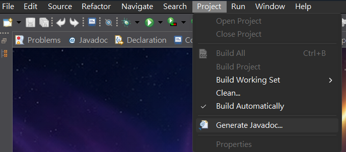

# Week 5 | Java Object-Oriented Programming Class Notes

**English edition** · [繁體中文](encapsulation-cla-packages-javadoc.zh-TW.md)

- **Class date:** 2026/10/13
- **Handout 1:** *Encapsulation*, Tessema Mengistu, Ph.D.; pp.1–13 covered.
- **Handout 2:** *Classes and Objects* (file `4_Classes_And_Objects.pdf`); covered p.41 Method Overloading, pp.44–46 the Math class, pp.47–57 wrapper classes and their uses; pp.42–43 not yet covered.
- **Handout 3:** *Command Line Arguments, Packages, and JavaDoc* (file `6_CLA_Packages_JavaDoc.pdf`); main text pp.3–18 and the p.19 references are fully covered, including in-class Q&A and screenshots.
- **Runnable example programs:** [`../src/`](../src) (Hello, Sum, StaticCalculator, InstanceCalculator)
- **How these notes are organized:** first the instructor's opening questions, then the handouts in page order; supplementary examples are marked separately.

## 1. The instructor's opening questions

### Q1: `private` and `public`?

`private` and `public` are **access modifiers**. They control which code is allowed to access a field or method.

| Modifier | Access scope | Beginner's way to remember it |
|---|---|---|
| `public` | Other classes can access it too, provided the class it belongs to is itself accessible | Open to the outside |
| `private` | In general, only code inside the class that declares it can access it directly | For use inside the class |

```java
class Student {
    public String name; // can be read and modified directly from outside
    private int age;    // cannot be read or modified directly from outside
}
```

**Connecting to the instance variables we learned earlier:**

```java
private int age;
```

- `private`: describes "who can access it".
- No `static`: the field declared here is an **instance variable**; every `Student` object has its own copy.

So **an instance variable can be `private` or `public`**; the two words describe different aspects.

### Opening note: private — modified within the class

Class shorthand: "private: modified within the classes". For ordinary classes, which is what we are discussing now, a more precise statement is:

> **A private member can be accessed directly only within the class that declares it.**
> A `private` member can be accessed directly only inside the class that declares it.

- **Access** includes both reading and modifying, not just modifying.
- The emphasis is on **the class that declares it**, not any other class.
- Outside code can still call `public` methods, which let code inside the class read or modify the data indirectly.
- The precise rule, for completeness: in Java, nested classes enclosed by the same top-level class can also access each other's `private` members; for now, think in terms of ordinary, non-nested classes.

```java
class Car {
    private int speed;

    public void setSpeed(int value) {
        if (value >= 0) {
            speed = value; // modified inside Car, the class that declares speed
        }
    }
}
```

Inside a method of another ordinary class:

```java
Car tesla = new Car();
// tesla.speed = 100; // not allowed: direct outside access to a private field
tesla.setSpeed(100);  // allowed: modified by a method inside Car
```

This simplified `Car` example is independent of the car example later on.

### Q2: The data is hidden by the class — can the data only be read and modified through methods?

**For the encapsulation approach introduced in this class, yes: if the data fields are `private`, outside code must work with the data through the accessible methods the object provides.**

Keep these apart:

- **Outside the class:** cannot read or write `private` fields directly.
- **Inside the class:** can read and write its own `private` fields directly.
- **Which operations are exposed:** decided by the methods the class provides; outside code is not necessarily allowed to get or change every piece of data.

> Data is not "automatically hidden just because it is in a class"; data hiding is achieved through access restrictions such as `private`.

## 2. Slides p.1 | Encapsulation

This week's topic is **Encapsulation**.

The core idea first: **an object protects its own data and uses methods to manage what outside code is allowed to do.**

## 3. Slides p.2 | Outline

This handout lists two topics:

1. **Encapsulation**
2. **Accessors and Mutators (methods that read and modify data)**

Covered so far up to p.13: accessors, mutators, constants, and a before/after comparison of code without and with encapsulation; supplementary examples are marked.

## 4. Slides p.3 | OOP Concepts

**OOP = Object-Oriented Programming**.

The handout lists three key concepts:

| Term | Meaning | Progress this session |
|---|---|---|
| Encapsulation | Bundling data and hiding it inside a class | Introduced starting this week |
| Inheritance | A class building on another class | Name listed on this page, not yet covered |
| Polymorphism | One interface, many forms | Name listed on this page, not yet covered |

## 5. Slides p.4 | The core of encapsulation

### 1. Hiding the data within a class

**Keep the data hidden inside the class.**

In this course's Java examples, this is done with `private` fields, so outside code cannot freely read or modify the data directly.

### 2. Making it available only through the methods

**Provide access to, or operations on, the data through methods.**

Methods are the interface outside code uses to work with the object. The class can decide which operations to allow, and it can check inside the method whether the input makes sense.

```text
Outside code
    │
    │ calls methods the object provides
    ▼
┌─────────────────────────┐
│ Object                  │
│   Methods               │
│       │ manage & check  │
│       ▼                 │
│   Data (internal)       │
└─────────────────────────┘
```

**Key point of the slide's diagram:** both Methods and Data sit inside the object; the outside connection goes to Methods, and Methods then interact with Data. This shows that outside code works with internal data through methods.

### 3. Each object protects and manages its own data

**Every object protects and manages its own data.**

The handout calls this property **self-governing**.

This means: an object uses the methods defined by its own class to manage the rules for reading and updating its internal data. For example, a student object can require that age never be less than 0.

> **The point of encapsulation: the object manages its own data, and outside code interacts with it through controlled methods.**

## 6. Slides p.5 | Why Encapsulation?

### 1. Hide the internal implementation so it can be changed later

**Internal implementation details** include how data is stored and organized, and how methods carry out their operations internally.

Encapsulation lets client code use an object through its public interface instead of depending directly on internal details. So when the internal implementation changes, the client does not have to change as long as the public interface and its agreed behavior stay compatible.

**Connecting to the car example:** `Car` can change how it stores speed internally, and outside code still uses `tesla.setSpeed(100)`.

### 2. Prevent accidental or deliberate misuse

The handout mentions accidental or willful mistakes, meaning outside code using the class in an inappropriate way, either by accident or on purpose.

For example, making `speed` `private` and checking the input in `setSpeed()` prevents outside code from bypassing that method and directly setting a value that breaks the rules.

**Note:** making a field `private` does not by itself check whether a value is reasonable; the checking rules still have to be written in a method or constructor.

### 3. Separate Implementation from Interface

| Term | Meaning | Car example |
|---|---|---|
| Interface | Which operations are offered to the outside, and how to use them | `setSpeed(int)`, `getSpeed()` |
| Implementation | How those operations are carried out internally | Which field stores the speed, how it is checked and updated |

Here the handout introduces **Data Abstraction**: users understand and use data through the operations they need, without having to know every implementation detail behind it.

> **Interface: how the outside uses it. Implementation: how the inside does it.**

## 7. Slides p.6 | Visibility Modifiers

The handout points out: controlling access scope with visibility modifiers is how data hiding in encapsulation is achieved.

### This week's focus: public and private

| Modifier | Handout keyword | Meaning |
|---|---|---|
| `public` | least restrictive | Fewest restrictions; outside classes can access public members, provided the class they belong to is accessible |
| `private` | most restrictive | Most restrictions; ordinary outside classes cannot access it directly; meant for use inside the declaring class |

**Instance data should be defined private.**

This is a design recommendation in this course: **make instance data `private`, and provide operations through appropriate methods.** It does not mean Java syntax forbids declaring `public` instance variables.

```java
private int speed; // protects the object's internal data
```

### Items to be covered next week

This page also lists Package-default and Protected; following the instructor's plan, this week only records their names, and their exact scope and usage are left for next week.

- **Package-default:** no access modifier written; also called package-private.
- **Protected:** uses the `protected` modifier.

> **How to remember it this week: data is usually private, and operations that need to be exposed are offered through public methods.**

## 8. Slides p.7 | Using Set and Get Methods

### 1. How does outside code work with private data?

Outside code cannot read or write `private` fields directly, but it can call the **set and get methods** the class exposes, so that code inside the class accesses the data.

### 2. Set Method: Setter / Mutator

- Usually a `public` method that outside code calls to set or modify a `private` field.
- Also called a **mutator method**; the focus is on "changing a value".
- The class decides which data may be modified, and can also validate the input before updating.

```java
public void setSpeed(int value) {
    if (value >= 0) {
        speed = value;
    }
}
```

### 3. Get Method: Getter / Accessor / Query

- Usually a `public` method that outside code calls to get data the class is willing to provide.
- Also called an **accessor method** or **query method**; the focus is on "querying or reading".
- The class decides which information to expose.

```java
public int getSpeed() {
    return speed;
}
```

**Terminology clarification:** the handout describes the get method with the word "displays"; a typical getter **returns data** and does not necessarily print it on the screen.

```java
int currentSpeed = tesla.getSpeed(); // the getter returns a value
System.out.println(currentSpeed);   // println is what displays it
```

The set/get method snippets above are supplementary examples that go in a `Car` class with a `private int speed` field; the calling snippet goes in a method of the client.

### 4. Why doesn't this violate private?

```text
Outside code accesses the field directly: tesla.speed = 100;    Not allowed
Outside code calls a public method:       tesla.setSpeed(100);  Allowed
```

In the second case, **the code that actually modifies `speed` is inside `Car`**, so the `private` access restriction is not violated.

| Method | Other names | Main purpose | Return type in this example |
|---|---|---|---|
| `setSpeed(int value)` | Setter / Mutator | Set or modify data | `void` |
| `getSpeed()` | Getter / Accessor / Query | Get data | `int` |

**Note:** you do not need a getter and setter for every field; `get` and `set` are naming conventions, not Java keywords.

> **Set changes the value, Get retrieves the value; the data is still managed inside the class.**

## 9. Slides p.8 | Constants can be public

Key point of the handout: **a constant's value cannot be changed, so it is acceptable to make constants `public`.**

This does not conflict with "ordinary instance data is usually `private`": protecting mutable data and exposing a fixed value are different situations.

Here is a supplementary example:

```java
public static final double PI = 3.14;
```

| Keyword | Role in this example |
|---|---|
| `public` | Outside code can read this constant |
| `static` | Belongs to the class and is shared by all objects; each circle does not need its own copy |
| `final` | Cannot be reassigned after initialization |
| `double` | A type that can store decimal numbers |
| `PI` | Constant names are usually uppercase; `3.14` is the approximate value chosen for this example |

If it is declared in `Circle`, it can be read as `Circle.PI`; `Circle.PI = 3.14159;` fails to compile.

**Note:** what makes a variable impossible to reassign is `final`, not `static`. If a `final` variable holds a reference to a mutable object or array, that does not mean the contents cannot change; `PI` here is a constant of the primitive type `double`.

## 10. Slides pp.9–13 | Before and after encapsulation

### 1. Page overview

| Page | Topic | What to look for |
|---|---|---|
| p.9 | Without Encapsulation: `Person` | `firstName`, `lastName`, `age` are not `private`; provides `display()` |
| p.10 | Without Encapsulation: `PersonTest` | The client modifies fields directly, and can even set `age` to `-21` |
| p.11 | With Encapsulation: `Person` | The three fields become `private`, and methods to get and set the names are provided |
| p.12 | With Encapsulation: `Person` continued | Provides `getAge()` and `setAge()`; setting a negative age prints a message and sets the age to `0` |
| p.13 | With Encapsulation: `PersonTest` | The client cannot access `private` fields directly and calls public methods instead |

**Scope reminder:** the fields on p.9 have no modifier, which makes them package-private, not `public`. The direct access on p.10 assumes both classes are in the same package; the full access rules are left for next week.

### 2. Design and behavior comparison

The method names below have been normalized to consistent camelCase; the spelling issues in the original slides are listed afterwards.

| Aspect | Without encapsulation: pp.9–10 | With encapsulation: pp.11–13 |
|---|---|---|
| Age field | `int age;` | `private int age;` |
| Name fields | `String firstName;`, `String lastName;` | `private String firstName;`, `private String lastName;` |
| Client sets age | `p1.age = 20;` | `p1.setAge(20);` |
| Client reads age | `p1.age` works within the same package | Uses `p1.getAge()` |
| Setting an unreasonable age | `p1.age = -21;`, the field becomes `-21` directly | `p1.setAge(-21);`, prints `wrong age`, the field becomes `0` |
| Who controls the data rules | The client can assign directly; no central check | `Person`'s `setAge()` checks in one place |
| Working with names | Direct field access | Through methods such as `setFirstName()`, `setLastName()` |
| Dependence on internal data | The client depends on field names and representation | The client mainly depends on public methods and their agreed behavior |
| Changing the internal implementation | Clients that use fields directly may need changes | When the public interface and behavior stay compatible, the client can stay as it is |

### 3. Client operation results compared

| Client code | Unencapsulated version (same package) | Encapsulated version |
|---|---|---|
| `p1.age = 20;` | Can modify directly | Compile error: `age` is `private` |
| `p1.age = -21;` | Can modify directly, producing an unreasonable value | Compile error: no direct access |
| `p1.setAge(20);` | The original has no such method | Allowed; age becomes `20` |
| `p1.setAge(-21);` | The original has no such method | The call is allowed, but by the method's rule it prints `wrong age` and sets age to `0` |
| `p1.lastName = "John";` | Can modify directly | Compile error: `lastName` is `private` |
| `p1.setFirstName("John");` | The original has no such method | With the method spelling normalized, can be modified through the public setter |
| `p1.setLastName("Smith");` | The original has no such method | With the method spelling normalized, can be modified through the public setter |

Each row in the table is a separate comparison. If the lines that cause compile errors are kept in a real program, the whole program will not compile; those lines must be deleted or commented out first.

### 4. p.12 age check: corrected braces

```java
public void setAge(int age) {
    if (age < 0) {
        System.out.println("wrong age");
        this.age = 0;
    } else {
        this.age = age;
    }
}
```

| Code | What it means |
|---|---|
| `int age` | The method parameter passed in by the caller |
| `this.age` | The instance variable of the current `Person` object |
| `this.age = age;` | Stores the passed-in value in the current object's field |

**Note:** when this handout gets a negative age it "changes it to `0`", not "keeps the old value". The earlier supplementary example does not update on a negative number; these are two different validation strategies. Encapsulation lets the class choose a strategy, but it does not choose one automatically.

### 5. Spelling and syntax issues in the original slides

These are the problems found after checking the slides, listed so that spelling mistakes are not mistaken for effects of encapsulation.

| Page | Issue in the original | Fix or explanation used in these notes |
|---|---|---|
| p.10 | `firstname` differs from `firstName` on p.9 | Normalized to `firstName`; Java is case-sensitive |
| p.10, p.13 | `dispaly()` | Should be `display()` |
| p.11 | `getfirsName()`, `getlastName()`, `setfirstName()` | Normalized to `getFirstName()`, `getLastName()`, `setFirstName()`, with the calling code made consistent |
| p.12 | `setlastName()` differs from `setLastName()` on p.13 | Normalized to `setLastName()` |
| p.12 | Missing the `}` that closes the `if` block before `else` | Use the corrected brace structure above |
| p.13 | The encapsulated version on pp.11–12 does not show a `display()` definition | To call it, add a `display()` with suitable visibility to the encapsulated `Person`, or use getters to get the data and print it |

**Note on the names:** p.10 sets `lastName` to `John` and `firstName` to `Smith`; p.13 uses `John` as the first name and `Smith` as the last name. This is a difference in the example's assignments, not encapsulation swapping the names automatically.

> **Without encapsulation: the client changes fields directly. With encapsulation: the client calls methods, and the class controls the data rules.**

## 11. In-class example | Encapsulating Circle: PI, radius, area(), circum()

This section is a supplementary circle example raised by the user, not code from the handout. As specified in the exercise, it uses `PI = 3.14`.

### 1. How is each member designed?

| Member | Declaration | Reason |
|---|---|---|
| `PI` | `public static final double` | A fixed constant; can be read publicly and is shared by all circles |
| `radius` | `private double` | Each circle's own mutable data; prevents direct outside changes |
| `setRadius()` | `public void` | Provides an entry point for setting the radius, and checks the value |
| `getRadius()` | `public double` | Lets outside code read the radius |
| `area()` | `public double` | Returns the area: πr² |
| `circum()` | `public double` | Returns the circumference: 2πr |

### 2. The Circle class

```java
public class Circle {
    public static final double PI = 3.14;
    private double radius;

    public void setRadius(double radius) {
        if (radius >= 0) {
            this.radius = radius;
        } else {
            System.out.println("Radius must be non-negative");
        }
    }

    public double getRadius() {
        return radius;
    }

    public double area() {
        return PI * radius * radius;
    }

    public double circum() {
        return 2 * PI * radius;
    }
}
```

Save it as `Circle.java`. In this teaching example the radius may be `0`; a new object's `radius` defaults to `0.0`. A negative input prints a message and keeps the old radius, which is a different strategy from the handout's `setAge()` "change it to 0".

### 3. How the client uses it

The following goes inside the `main` method of another class:

```java
Circle c = new Circle();
c.setRadius(5);

System.out.println(Circle.PI);    // 3.14
System.out.println(c.getRadius()); // 5.0
System.out.println(c.area());      // 78.5
System.out.println(c.circum());    // about 31.4; floating-point output may have trailing digits

// c.radius = 10; // compile error: radius is private
// Circle.PI = 3; // compile error: PI is final and cannot be reassigned

c.setRadius(10); // correct: set through a public method
```

### 4. Why not also store area and circumference?

Area and circumference can be calculated from the radius, so in this example they do not need to be stored as fields. Every call to `area()` or `circum()` calculates with the current radius, which avoids "the radius changed, but the stored area was never updated".

`area()` and `circum()` also show that **encapsulation is not only about getters/setters; a class can also provide meaningful calculations and operations.** Outside code gets results without touching `radius` directly.

> **PI is public but cannot be changed; radius is hidden and managed by methods; area() and circum() provide calculated results to the outside.**

## 12. Supplementary example | Connecting the opening questions with p.4

The following is supplementary code for the concepts from class; it is not code from handout pp.1–4.

```java
class Student {
    private int age; // hidden data; every object has its own copy

    public int getAge() {
        return age; // reading is provided by a method
    }

    public void setAge(int value) {
        if (value >= 0) {
            age = value; // update only if the check passes
        }
    }
}

public class Main {
    public static void main(String[] args) {
        Student s = new Student();

        // s.age = 20;                  // compile error: cannot modify directly
        // System.out.println(s.age);   // compile error: cannot read directly

        s.setAge(20);                   // modify through a method
        System.out.println(s.getAge()); // prints 20

        s.setAge(-5);                   // fails the check, no update
        System.out.println(s.getAge()); // still prints 20
    }
}
```

This complete example can be saved as `Main.java`.

| Code | Concept |
|---|---|
| `private int age` | Data hiding: restricts direct outside access to the data |
| `public int getAge()` | A method that lets outside code read the data, usually called a getter / accessor |
| `public void setAge(int value)` | A method that lets outside code modify the data, usually called a setter / mutator |
| `if (value >= 0)` | The object checks data through its method, which reflects self-governing |

**Not every field needs a getter and a setter.** A class can provide only a read method, or provide specific operations, without letting outside code set the value directly.

## 13. In-class Q&A | Modifying data, data structures, and the car example

**Question:** "modified data, data structure? Using cars as an example, how do the class, the Sheron car, and the Tesla relate?"

Below, the question is read as "what is the difference between modifying data and modifying the internal data structure", with Sheron and Tesla treated as two concrete cars for the demonstration. This is a conceptual supplement, not a summary of an additional handout page.

### 1. The class and two cars

```java
class Car {
    private String name;
    private int speed;

    public Car(String name) {
        this.name = name;
    }

    public void setSpeed(int value) {
        if (value >= 0) {
            speed = value;
        }
    }

    public int getSpeed() {
        return speed;
    }
}
```

The following operations go in the `main` method of another class:

```java
Car sheron = new Car("Sheron");
Car tesla = new Car("Tesla");

sheron.setSpeed(60);
tesla.setSpeed(80);

System.out.println(sheron.getSpeed()); // 60
System.out.println(tesla.getSpeed());  // 80

// tesla.speed = 100; // compile error: speed is private
tesla.setSpeed(100);  // modify the Tesla object's data through a method
```

| Name | Role in this example |
|---|---|
| `Car` | Class: defines what data and operations a car has |
| The objects created by the two `new Car(...)` calls | Two different instances / objects: two concrete cars |
| `sheron`, `tesla` | Reference variables: each points to one of the two cars |
| `name`, `speed` | Instance variables: each car has its own data |
| `setSpeed()`, `getSpeed()` | Methods: manage modifying and reading the data |

**A brand or model name by itself is not an instance.** Here the names label two actual cars; depending on what the program needs, you could also design `Tesla` as a class, but that is a different way of modeling.

### 2. Modifying data vs. modifying the data structure

| Concept | Meaning | Car example |
|---|---|---|
| Modify data | Change the value an object currently holds | Change Tesla's `speed` from `80` to `100` |
| Modify the internal data representation / structure | Change how the program stores or organizes data | Originally a single `speed` field is stored directly; later an internal state object holds the speed and other car conditions |

`Data structure` usually means how data is organized, such as arrays, lists, and maps; simply changing the speed value is not changing the data structure. In the context of encapsulation, people also often talk about the broader "internal data representation".

Suppose `Car` changes how it stores speed internally. As long as `setSpeed(int)` and `getSpeed()` keep the same usage and outward behavior, outside code can keep writing:

```java
tesla.setSpeed(100);
System.out.println(tesla.getSpeed());
```

Outside code does not need to know where the data is actually stored. **One benefit of encapsulation is that it reduces outside code's dependence on the internal data representation.**

> **Changing data: changing the speed value. Changing the internal structure: changing how speed is stored. Encapsulation: outside code works through methods and does not need to know how things are stored inside.**

## 14. In-class Q&A | Interface, API Calls, and Client Code

**Keywords noted in class:** interface, methods / API calls, intact, modifying the underlying data structure, the client side.

Based on the context of this discussion, it can be summarized as: **as long as the public interface and its agreed behavior stay compatible, a class can change its internal data structure without forcing the client code that uses it to change too.**

### 1. What is an interface?

Here, **interface** means the way a class is meant to be used from the outside: mainly the methods outside code can call, plus those methods' parameters, return values, and agreed behavior.

- **API (Application Programming Interface)**: the interface a program offers for other programs to use.
- **API call / method call**: the act of actually calling a method in the interface.
- Here, interface is a general concept and **does not necessarily mean Java's `interface` keyword**.
- An API call is not necessarily a network request either; calling a method on an object in the same Java program is also using that class's API.

```java
// methods that Car offers to the outside
public void setSpeed(int value)
public int getSpeed()
```

The above sketches the method declarations with the bodies omitted; the actual method calls are below:

```java
tesla.setSpeed(100);
int currentSpeed = tesla.getSpeed();
```

### 2. Who is the client?

**Client code is "code that uses this class or service".** In this example, the `main` method, other classes, or other methods that call `Car`'s methods can all be clients of `Car`.

This does not necessarily involve a browser, a front end, or another computer; "client" describes the role of the user / caller.

```text
Client code (code that uses Car)
    │
    │ tesla.setSpeed(100)
    ▼
Car's public interface (public methods)
    │
    ▼
Car's internal implementation and private data
```

### 3. Intact: which parts must stay unchanged?

**Intact** here can be understood as "the original way of using it is kept and not broken".

For example, `Car` originally stores speed in a single `speed` field and later switches to an internal car-condition object. As long as it still provides compatible `setSpeed(int)` and `getSpeed()`, and the agreed behavior (the unit of speed, what setting and reading mean) does not change, the client's existing calls keep working.

| Part | Does it need to change in this example? |
|---|---|
| `Car`'s internal data structure | Can be changed |
| The implementation inside `Car`'s methods | May need adjusting to fit the new structure |
| The client's `tesla.setSpeed(100)` call | No change needed when the public interface and agreed behavior stay compatible |

**Keeping only the method names is not enough.** If the parameters, return type, or agreed behavior change, the client may still be affected. For example, if the speed unit changes from km/h to mph, the results differ even though the method names are the same.

> **The client knows "how to call it"; the class is responsible for "how it works inside". Encapsulation lets the inside change while the way it is used from outside stays the same.**

## 15. Key points to remember

| Keyword | What to remember |
|---|---|
| `public` | Open to outside access |
| `private` | Restricts direct outside access |
| Data hiding | Hiding and protecting internal data |
| Encapsulation | Organizing data and its related operations in an object, controlling how outside code uses the data |
| Methods | Provide the interface for working with data, and can include checking rules |
| Self-governing | Every object protects and manages its own data |
| Interface / API | The operations and usage rules offered to the outside |
| Implementation | How data is stored and operations are carried out internally |
| Data Abstraction | Using data through the necessary operations without knowing all internal details |
| Setter / Mutator | A method that sets or modifies data |
| Getter / Accessor / Query | A method that gets or queries data |
| `final` constant | Cannot be reassigned after initialization; primitive-type constants can be read publicly |
| `this.age` | The current object's `age` field, distinguished from a parameter with the same name |

> **Data is hidden inside, outside code works through methods, and the object manages its own rules.**

---

## 16. Coming up next week

- `protected`
- Default access (no access modifier written; also called package-private)

Instructor's note: these two access levels will be covered next week; they are not expanded on this week.

***Encapsulation* is recorded up to p.13; p.14 is not yet covered. Following the class plan, we then switched to *5_Classes_And_Objects* p.41.**

---

## 17. Next class | Method Overloading

**New handout:** *5_Classes_And_Objects* p.41. Page numbers below refer to the new handout.

### 1. What is method overloading?

**Using the same method name but defining different lists of parameter types.** These methods usually do similar work, letting callers provide input in different forms.

| How overloaded methods are distinguished | Example signatures | Difference |
|---|---|---|
| Number of parameters | `area(double)` and `area(double, double)` | One parameter vs. two parameters |
| Parameter types | `print(int)` and `print(String)` | Integer vs. string |
| Order of parameter types | `show(String, int)` and `show(int, String)` | The types of the first and second parameters are in a different order |

Only the signatures are listed above, not complete method declarations. **"Order" means the order of the types**; swapping the names of two `double` parameters still gives `(double, double)` and does not create a new overload.

### 2. In-class question: what is a signature?

A **method signature** is the information Java uses to identify a method. For the ordinary, non-generic methods in this course, you can remember it as:

> **Method signature = method name + parameter types in order.**

For example:

```java
public double area(double radius) {
    return 3.14 * radius * radius;
}
```

| Part of the declaration | Meaning | Part of the signature in this example? |
|---|---|---|
| `public` | Access modifier | No |
| The first `double` | Return type | No |
| `area` | Method name | Yes |
| The `double` inside the parentheses | Parameter type | Yes |
| `radius` | Parameter name | No |

So the signature is **`area(double)`**.

### 3. Why doesn't changing only the return type or parameter name work?

The following sketches method declarations with the bodies omitted:

```java
double area(double radius)
int area(double radius)
```

Both have the signature `area(double)`; **you cannot define these two methods in the same class by giving them different return types**, otherwise you get a compile error.

Likewise, `area(double radius)` and `area(double r)` have the same signature; simply renaming a parameter does not create an overload.

### 4. Supplementary example: overloading area calculations

These two methods can go in the same class:

```java
public double area(double radius) {
    return 3.14 * radius * radius; // area of a circle
}

public double area(double width, double height) {
    return width * height;        // area of a rectangle
}
```

| Example call | Matching signature | Result |
|---|---|---|
| `area(5.0)` | `area(double)` | Circle area: `78.5` |
| `area(5.0, 3.0)` | `area(double, double)` | Rectangle area: `15.0` |

This is a standalone teaching example of overloading; it differs from the `area()` in the earlier `Circle` section, which uses the object's internal radius. A no-parameter `area()` is itself yet another signature.

### 5. How does Java choose which method to call?

The handout points out that Java chooses the suitable method based on the number, types, and order of the arguments in the call. Overload selection here happens at **compile time**; if no method applies, or a single best method cannot be chosen, compilation fails.

| Term | Where it appears | Example |
|---|---|---|
| Parameter | In the method declaration | `double radius` |
| Argument | Supplied when calling the method | The `5.0` in `area(5.0)` |

The handout uses `println` as an example of overloading:

```java
System.out.println(5);       // uses the int version
System.out.println(3.14);    // uses the double version
System.out.println("Hello"); // uses the String version
```

> **Overloading: same method name, different list of parameter types. The signature includes neither the return type nor the parameter names.**

### 6. In-class Q&A: why add static to sum()?

The two methods below have a different order of parameter types, so **they form an overload even without `static`**:

```java
public float sum(int num1, float num2) {
    return num1 + num2;
}

public float sum(float num1, int num2) {
    return num1 + num2;
}
```

Their signatures are `sum(int, float)` and `sum(float, int)`.

**Adding `static` is usually about how the method is called, not a requirement of overloading.** If the calling code is in `public static void main(String[] args)` and you want to write `sum(...)` directly, you can declare the methods you want to call this way as `static`.

| Declaration | Who the method belongs to | How to use it from `static main()` |
|---|---|---|
| `public float sum(...)` | An instance method of the object | Create an object first, then call `object.sum(...)` |
| `public static float sum(...)` | A static method of the class | Use `ClassName.sum(...)`; inside the same class you can write `sum(...)` directly |

**Approach A: both overloaded versions use static.**

```java
public class Calculator {
    public static float sum(int num1, float num2) {
        return num1 + num2;
    }

    public static float sum(float num1, int num2) {
        return num1 + num2;
    }

    public static void main(String[] args) {
        System.out.println(sum(2, 3.5f)); // sum(int, float)
        System.out.println(sum(2.5f, 3)); // sum(float, int)
    }
}
```

**Approach B: keep them as instance methods and call them after creating an object.** If you remove `static` from both `sum` declarations in the example above, change the body of `main` to:

```java
Calculator c = new Calculator();
System.out.println(c.sum(2, 3.5f));
System.out.println(c.sum(2.5f, 3));
```

`main` is a static method, so it does not automatically have a `Calculator` object to call instance methods on; but it can create an object itself and call the methods through that object.

**A small reminder about calls:** `3.5f` is a `float`; writing `3.5` gives a `double`. With only these two overloads, `sum(2, 3)` is ambiguous: both versions need one `int` converted to `float`, so there is no single best version.

> **Overloading decides "which parameter version to use"; static decides that the method belongs to the class, so no object has to be created before calling it. static itself cannot be used to tell apart methods with the same signature.**

This is a supplement based on the declarations the user provided; the complete calling code that had to be changed has not been seen yet, so "to call it directly from main" is a common reason, not a confirmed description of the original program.

### 7. Full programs compared: without static and with static

The two programs can be run separately; the file name must match the public class name. Both versions keep the sum(int, float) and sum(float, int) overloads.

**Version A: InstanceCalculator.java. No static; create an object first.**

```java
public class InstanceCalculator {
    // No static: call these methods through an object.
    public float sum(int num1, float num2) {
        return num1 + num2;
    }

    public float sum(float num1, int num2) {
        return num1 + num2;
    }

    public static void main(String[] args) {
        InstanceCalculator calculator = new InstanceCalculator();

        float result1 = calculator.sum(2, 3.5f);
        float result2 = calculator.sum(2.5f, 3);

        System.out.println(result1); // 5.5
        System.out.println(result2); // 5.5
    }
}
```

`new InstanceCalculator()` creates an object, and `calculator` holds its reference. Then `calculator.sum(...)` calls that object's method.

**Version B: StaticCalculator.java. Add static; call through the class.**

```java
public class StaticCalculator {
    // Static: call these methods through the class.
    public static float sum(int num1, float num2) {
        return num1 + num2;
    }

    public static float sum(float num1, int num2) {
        return num1 + num2;
    }

    public static void main(String[] args) {
        float result1 = StaticCalculator.sum(2, 3.5f);
        float result2 = StaticCalculator.sum(2.5f, 3);

        System.out.println(result1); // 5.5
        System.out.println(result2); // 5.5
    }
}
```

No `new StaticCalculator()` is needed here; call it directly with the class name, `StaticCalculator.sum(...)`. Inside main in the same class, you can also omit the class name and write `sum(...)`.

Each of the two programs produces the same output:

```text
5.5
5.5
```

| What to look at | Without static | With static |
|---|---|---|
| Declaration | `public float sum(...)` | `public static float sum(...)` |
| Creating an object | `new InstanceCalculator()` | Not needed |
| How to call | `calculator.sum(...)` | `StaticCalculator.sum(...)` |
| Can it be overloaded? | Yes | Yes |

The `f` in `3.5f` and `2.5f` means float. The two methods have a different order of parameter types, so they correspond to `(int, float)` and `(float, int)` respectively.

**Remember the calling style first: without static, call through an object; with static, you can call through the class. You do not have to add static in order to overload.**

## 18. Slides pp.44–46 | The Math class: static methods and constants (condensed)

**`Math` is Java's built-in math utility class. It is in the `java.lang` package, so no import is needed.** All the methods in this section are `static`; write `Math.method(...)` directly without creating an object. This is a real example of "calling static methods through the class" from earlier.

The wording "Package java.lang.Math" on handout p.45 should be clarified: the package is `java.lang`, and `Math` is a class in it.

| Function | Code | Result / key point |
|---|---|---|
| Absolute value | `Math.abs(-5)` | `5` (p.44 mentions the function; this is a supplementary example) |
| Power | `Math.pow(2, 3)` / `Math.pow(3, 2)` | `8.0` / `9.0` |
| Square root | `Math.sqrt(36)` | `6.0` |
| Natural logarithm, base e | `Math.log(1000)` | About `6.9078` |
| Base-10 logarithm | `Math.log10(1000)` | `3.0` |
| Larger value | `Math.max(54, 70)` | `70` |
| Nearest integer | `Math.round(3.14159)` | `3`; this example passes a `double` and returns a `long` |
| Sine | `Math.sin(Math.toRadians(90))` | `1.0`; first convert 90 degrees to radians |
| Pseudo-random number | `Math.random()` | Returns a `double` in the range `0.0 <= value < 1.0`; the result varies |

**Trigonometric functions use radians, not degrees.** `Math.sin(90)` computes the sine of 90 radians, about `0.894`; to compute it for 90 degrees, first convert with `Math.toRadians(90)`.

**Both built-in constants are `public static final double`:**

| Constant | Meaning | Approximate value |
|---|---|---|
| `Math.PI` | Pi (π): the ratio of a circle's circumference to its diameter | `3.141592653589793` |
| `Math.E` | e, the base of the natural logarithm | `2.718281828459045` |

Constants are fields, so use them **without parentheses**: `Math.PI`; methods take parentheses: `Math.sqrt(36)`. These constants are finite-precision `double` approximations and cannot be reassigned.

**Connecting to the circle example (the snippet below goes inside a method):**

```java
double radius = 5;
double area = Math.PI * radius * radius;
double circumference = 2 * Math.PI * radius;
```

The original exercise specified `PI = 3.14`; here the built-in `Math.PI` is used instead, giving a more precise approximation of pi.

> **Call Math methods directly through the class; check for radians with trig functions; PI / E are constants, used without parentheses.**

## 19. Slides pp.47–48 | Wrapper Classes

**A wrapper class represents a primitive value as an object, so the data can be used where an object is required.** For example, `int` is a primitive type and `Integer` is its wrapper class. All the wrapper classes below are in `java.lang`, so no import is needed.

| Primitive type | Wrapper class |
|---|---|
| `byte` | `Byte` |
| `short` | `Short` |
| `int` | `Integer` |
| `long` | `Long` |
| `float` | `Float` |
| `double` | `Double` |
| `char` | `Character` |
| `boolean` | `Boolean` |

**Remember especially:** `int → Integer` and `char → Character`; it is not just capitalizing the first letter.

The handout also lists `void → Void`: this is a special case. `void` means a method returns no value; it is not a ninth primitive data type. `Void` is not used to wrap ordinary data values, and you cannot create instances of it the way you can with ordinary wrapper classes.

**Why do we need wrapper classes?**

| Situation | Reason and example |
|---|---|
| Containers that require objects | For example `ArrayList<Integer>`; a generic type argument cannot be written as `ArrayList<int>` |
| A method whose parameter type is `Object` | You can pass wrapper objects such as `Integer`, because they are objects too |

**Note: Java supports autoboxing, so sometimes you can write a primitive value directly and the compiler arranges for it to be converted to a wrapper object.** The handout's "a primitive cannot be used as an Object" stresses that the two are different types; it does not mean the code below fails to compile:

```java
int number = 10;        // primitive type
Integer wrapped = 10;  // autoboxing: int → Integer
Object value = 10;     // boxed into an Integer first, then used as an Object
```

A complete supplementary example (save it as `WrapperDemo.java`):

```java
import java.util.ArrayList;

public class WrapperDemo {
    public static void show(Object value) {
        System.out.println(value);
    }

    public static void main(String[] args) {
        ArrayList<Integer> numbers = new ArrayList<>();
        numbers.add(10); // autoboxing; the container stores an Integer

        show(20); // autoboxed, then passed to the Object parameter
        System.out.println(numbers.get(0));
    }
}
```

The output is `20`, then `10`. In this example only `ArrayList` needs an import; `Integer` and `Object` do not.

> **A primitive is a basic value; a wrapper is its object form. Use wrapper classes when an object is required; Java can often autobox for you.**

## 20. Slides pp.49–57 | Creating, converting, and common utilities of wrapper classes (condensed)

**The core idea: wrappers do more than represent primitive values as objects; they also provide methods for parsing strings, converting types, range constants, and checking data.** The content of these pages is combined below; examples and clarifications of easily confused points are added as supplements.

### 1. Creating wrapper objects and converting data (pp.49–51)

The handout demonstrates wrapper objects with constructors such as `new Integer(40)` and `new Double("8.2")`; the notes below use autoboxing or `valueOf()` instead, and the latter does not guarantee a new object is created each time.

| Goal | Example (inside a method) | Result type / meaning |
|---|---|---|
| Primitive value → wrapper object | `Integer age = 40;` | Autoboxed to `Integer` |
| String → wrapper object | `Double num = Double.valueOf("8.2");` | A `Double` object |
| Character → wrapper object | `Character symbol = '&';` | A `Character` object |
| String → primitive integer | `Integer.parseInt("3")` | `int`, value `3` |
| String → primitive decimal | `Double.parseDouble("4.7")` | `double`, value `4.7` |
| String → primitive long integer | `Long.parseLong("123456789")` | `long`, value `123456789` |
| Numeric wrapper object → another primitive numeric type | `Integer.valueOf(4).floatValue()` | `float`, value `4.0f` |
| Decimal wrapper object → integer | `Double.valueOf(8.2).intValue()` | `int`, value `8`; this example truncates the decimal part rather than rounding |

**Keep the three kinds of methods apart:** `parseXxx()` parses into a primitive value; `valueOf()` gets a wrapper object; a numeric object's `xxxValue()` extracts the value as a specific primitive numeric type. When a numeric string has an invalid format or is out of the target integer range, parsing may throw a `NumberFormatException`.

`Character` has no constructor that takes a `String`; characters use single quotes, for example `'&'`. You cannot create instances of `Void` the way you can with ordinary wrapper classes.

### 2. Range constants and Integer utilities (pp.52–53)

| Constant / method | Example result and purpose |
|---|---|
| `Integer.MIN_VALUE` | `-2147483648`, the smallest `int` |
| `Integer.MAX_VALUE` | `2147483647`, the largest `int` |
| `Integer.parseInt("101", 2)` | `5`: parses a binary string into an `int`; the second argument is the radix (number base) |
| `Integer.toBinaryString(5)` | `"101"`: returns the binary representation as a string |
| `Integer.toHexString(255)` | `"ff"`: returns the hexadecimal representation as a string |

**Clarifying p.52:** you cannot read every `MIN_VALUE` as "the most negative number". `Float.MIN_VALUE` and `Double.MIN_VALUE` are the **smallest positive nonzero values** the type can represent; the most negative finite values are `-Float.MAX_VALUE` and `-Double.MAX_VALUE`.

### 3. Common Double, Boolean, and Character methods (pp.54–56)

| Class | Member | Purpose / example |
|---|---|---|
| `Double` | `valueOf(String)` | Converts a numeric string to a `Double` object |
| `Double` | `isInfinite(double)` | Checks whether the value is positive or negative infinity; returns `boolean` |
| `Double` | `isNaN(double)` | Checks whether the value is NaN (Not a Number); returns `boolean` |
| `Double` | `doubleToLongBits(double)` | Represents a `double` as a `long` bit pattern; it does not convert the decimal value to an integer |
| `Boolean` | `TRUE`, `FALSE` | `Boolean` object constants for true and false |
| `Boolean` | `valueOf("true")` | Returns a `Boolean` representing true; only a string equal to `"true"` ignoring case is true, any other value is false |
| `Boolean` | `booleanValue()` | Gets the primitive `boolean` from a `Boolean` object |
| `Boolean` | `getBoolean(String name)` | Reads the Java system property with that name and checks whether its value is `"true"`; it does not parse the string passed in directly |
| `Character` | `charValue()` | Gets the primitive `char` from a `Character` object |
| `Character` | `isDigit('7')` | `true`: checks whether it is a digit character |
| `Character` | `isLetter('A')` | `true`: checks whether it is a letter |
| `Character` | `isLetterOrDigit('!')` | `false`: checks whether it is a letter or digit |

**Clarifying the layout of p.54:** converting a string to a `Double` is the job of `valueOf(String)`; `isNaN()` checks for NaN and does not do string conversion.

### 4. Quick recap

```java
int a = Integer.parseInt("40");      // String → primitive
Integer b = Integer.valueOf("40");  // String → wrapper object
int c = b.intValue();                // wrapper object → primitive
boolean digit = Character.isDigit('7'); // check a character
```

The snippet above goes inside a method. `parseInt()`, `valueOf()`, and `isDigit()` are static methods called through the class; `b.intValue()` is an instance method called through an object.

> **parse: parse into a primitive value; valueOf: get a wrapper object; xxxValue: get the value out of an object; isXxx: return a check result.**

**p.57 References:** Herbert Schildt, Danny Coward, *Java: The Complete Reference*, 13th edition, McGraw-Hill, 2024, Chapters 6 and 7. This page is the handout's bibliography and adds no new programming concepts.

**Current progress: *5_Classes_And_Objects* is covered up to its last page, p.57; it covers p.41 and pp.44–57, while pp.42–43 are not yet covered.**

---

## 21. New handout pp.3–6 | Command-Line Arguments, compiling and running

**Source:** *Command Line Arguments, Packages, and JavaDoc*. Handout file name `6_CLA_Packages_JavaDoc.pdf`.

### 1. What are command-line arguments?

**Command-line arguments**: input data written after the class name when you start a program.

```text
java Hello John Smith
```

| Part | Meaning |
|---|---|
| `java` | Starts a Java program |
| `Hello` | The name of the class to run |
| `John` | The first argument, goes into `args[0]` |
| `Smith` | The second argument, goes into `args[1]` |

The Java runtime puts these arguments into `String[] args` and passes it to the `main` method used in the handout. In the example above, `args.length` is `2`; array indexes start at `0`.

### 2. Complete program: Hello.java

The example below combines the greeting program from p.5 with the argument-count check from p.6; the file name is `Hello.java`.

```java
public class Hello {
    public static void main(String[] args) {
        if (args.length != 2) {
            System.out.println("Please enter first name and last name.");
            return;
        }

        System.out.println("Hello " + args[0] + " " + args[1]);
    }
}
```

Here `return;` ends `main`. Checking the count first avoids accessing array elements that do not exist when there are too few arguments.

### 3. The instructor asked "how do you compile": compiling and running are two steps

In an environment with the JDK installed where `javac` and `java` already work, open a command line and change to the folder that contains `Hello.java`:

| Step | Command | What happens |
|---|---|---|
| Compile | `javac Hello.java` | Compiles the source code into bytecode, producing `Hello.class` |
| Run | `java Hello John Smith` | Runs `Hello`, passing `John` and `Smith` into `main` |

Output:

```text
Hello John Smith
```

```text
Hello.java ── compiled by javac ──▶ Hello.class
                                         │
                               java Hello John Smith
                                         │
                                         ▼
                        main receives ["John", "Smith"]
```

**Arguments are run-time input, not compile-time input.** Switch to `java Hello Alice Chen` and the same `Hello.class` prints `Hello Alice Chen`; you do not need to recompile just because the name changed. You only need to recompile this program after changing the Java source code.

This section follows the handout's two-step process: `javac` is followed by `Hello.java`; `java` is followed by the class name `Hello`, not `Hello.class`.

### 4. Connecting back to the static and overload points the instructor mentioned

Handout pp.4–5 use:

```java
public static void main(String[] args)
```

Here `static` lets the launcher call this entry method **without first creating a `Hello` object**; `String[] args` receives the command-line input. The two have different jobs.

**Static does not prevent or eliminate method overloading.** Static methods can still have different parameter-type lists and form overloads. The beginning of this handout does not say anything like "static is there to avoid overloading", so it is currently impossible to confirm what the instructor's spoken remark "to avoid this situation" referred to, and it is not recorded as a Java rule.

> **javac compiles; java launches; args receives run-time input; static main does not require creating an object of the main class first.**

### 5. Real in-class example: when Firstjava gets no name, only the second line fails

Based on the in-class description, the following complete program reproduces the same behavior; it is not the instructor's original source code. Save it as `Firstjava.java`:

```java
public class Firstjava {
    public static void main(String[] args) {
        System.out.println("Hi this is my Firstjava.");
        System.out.println("My name is " + args[0]);
    }
}
```

**Compile first:**

```text
javac Firstjava.java
```

A successful compile produces `Firstjava.class`. `args[0]` is legal in terms of syntax and types, but whether the element can be read depends on whether the array has data at run time.

| Run command | Contents of `args` | Result |
|---|---|---|
| `java Firstjava` | Empty array `[]`, `args.length == 0` | The first println succeeds; the second println throws `ArrayIndexOutOfBoundsException` when it evaluates `args[0]` |
| `java Firstjava Claire` | `["Claire"]`, `args.length == 1` | Both lines succeed; `args[0]` is `"Claire"` |

**When no name is given:** the line below is printed first, and then the program terminates because of an unhandled exception.

```text
Hi this is my Firstjava.
```

On the second line, `"My name is " + args[0]` must be fully evaluated before it can be handed to `println` for printing; reading `args[0]` already fails, so not even `My name is ` gets printed. This is a **runtime error**, not a compile error.

**When a name is given:**

```text
java Firstjava Claire
```

Output:

```text
Hi this is my Firstjava.
My name is Claire
```

**How to fix it:** to let the program finish normally even when no name is given, change the second println to:

```java
if (args.length > 0) {
    System.out.println("My name is " + args[0]);
} else {
    System.out.println("Please enter your name.");
}
```

After changing the source code, run `javac Firstjava.java` again. Note that this in-class example only needs one name argument; the earlier `Hello` example needs two arguments, first name and last name, so the check condition is different.

> **A successful compile does not guarantee every run succeeds. If no argument is passed, args is an empty array; check the length before reading args[0].**

### 6. Why does it still print only John after changing the .java file without recompiling?

Suppose the old program has been compiled, and the logic of the second line in `Firstjava.class` is:

```java
System.out.println("My name is " + args[0]);
```

Then `Firstjava.java` is changed to the following and saved:

```java
System.out.println("My name is " + args[0] + " " + args[1]);
```

If you run it directly without recompiling:

```text
java Firstjava John Smith
```

**What runs is still the old `Firstjava.class`, not the `.java` you just changed.** So the output is still:

```text
Hi this is my Firstjava.
My name is John
```

Both `John` and `Smith` were passed in, as `args[0]` and `args[1]`; the old program only uses `args[0]`, so Smith is not shown.

| File | State after changing and saving the source, before recompiling |
|---|---|
| `Firstjava.java` | New program: reads `args[0]` and `args[1]` |
| `Firstjava.class` | Old program: still reads only `args[0]` |

**The correct update process: save → compile → run.**

```text
javac Firstjava.java
java Firstjava John Smith
```

Only after a successful recompile updates the `.class` does the output become:

```text
Hi this is my Firstjava.
My name is John Smith
```

**Two details:** the array in this example is named `args`, which must match the declaration `main(String[] args)`; writing `args[0] + args[1]` directly gives `JohnSmith`, so you need to add `" "` to get a space. Once the program reads two arguments, the safety check should also confirm `args.length >= 2`.

> **Changing the input arguments does not require recompiling; changing the program logic does. java Firstjava runs the .class.**

## 22. New handout p.7 | Exercise: read two integers from the command line and add them

**Task:** accept two command-line arguments, add them as integers, and print the sum; when the number of arguments is wrong, display `Two ints are required`.

### Complete program: Sum.java

```java
public class Sum {
    public static void main(String[] args) {
        if (args.length != 2) {
            System.out.println("Two ints are required");
            return;
        }

        int num1 = Integer.parseInt(args[0]);
        int num2 = Integer.parseInt(args[1]);
        int sum = num1 + num2;

        System.out.println("The sum is " + sum);
    }
}
```

### Compiling and running

Save the program as `Sum.java`, and in that folder's command line enter, in order:

```text
javac Sum.java
java Sum 10 89
```

Output:

```text
The sum is 99
```

If you enter only `java Sum`, it prints `Two ints are required`, and `return;` ends `main` without accessing `args[0]` or `args[1]`.

### In-class screenshot: reference for the compile and run commands

```text
...\src>javac Add.java

...\src>java Add 10 9
The sum is 19
```

The class name used in class is `Add`, so the commands are:

```text
javac Add.java
java Add 10 9
```

The output is `The sum is 19`. Run the commands in the folder that contains `Add.java`; `...\src>` is the command-line prompt and should not be typed. If you use the `Sum.java` provided above, change `Add` in the commands to `Sum`.

### What does each step do?

| Code | Meaning |
|---|---|
| `args.length != 2` | Checks whether the number of arguments is not two |
| `return;` | Ends the current `main` method early |
| `args[0]`, `args[1]` | Gets the strings `"10"` and `"89"` |
| `Integer.parseInt(args[0])` | Converts the string `"10"` to the integer `10` |
| `num1 + num2` | Integer addition, giving `99` |
| `"The sum is " + sum` | Joins the message and the result into a string and prints it |

**Why can't you just write `args[0] + args[1]`?** Because `args` is a `String[]`, adding two strings concatenates them into `"1089"` instead of the number `99`.

```text
Command-line input 10 89
       ↓
args: "10", "89" (String)
       ↓ Integer.parseInt()
      10, 89 (int)
       ↓ add
        99
```

This basic version assumes, as the task states, that the input is integer text that can be parsed into an `int`; the argument-count check does not check whether the strings are valid integers. For example, entering `abc` makes `parseInt()` throw a `NumberFormatException`.

> **Check the count → convert strings to integers → add → print the result.**

## 23. New handout pp.8–11 | Package: organizing related classes and resolving name conflicts

### 1. What is a package?

**A package is an organizing structure that puts related classes and interfaces in the same namespace.** You can first think of it as a folder that groups code by function; in a typical Java project, package names also map to the folder structure.

The system functions the instructor gave as examples can be summarized in the table below; the package and class names are illustrative examples added based on the concepts from class:

| Function | Example package name | Example related classes |
|---|---|---|
| Inventory management | `shop.inventory` | `Product`, `Stock` |
| Shipping | `shop.shipping` | `Shipment`, `Tracking` |
| Payment processing | `shop.payment` | `Payment`, `Refund` |
| Customer management | `shop.customer` | `Customer`, `Address` |

```text
src/
└── shop/
    ├── inventory/
    │   ├── Product.java
    │   └── Stock.java
    ├── shipping/
    │   ├── Shipment.java
    │   └── Tracking.java
    ├── payment/
    │   ├── Payment.java
    │   └── Refund.java
    └── customer/
        ├── Customer.java
        └── Address.java
```

### 2. Declaring a package and using import

For example, `src/shop/inventory/Product.java`:

```java
package shop.inventory;

public class Product {
    // data and methods related to inventory products
}
```

The full name of this class is **`shop.inventory.Product`**.

| Code | Purpose |
|---|---|
| `package shop.inventory;` | Declares which package the classes in this file belong to |
| `import shop.inventory.Product;` | Lets other source files refer to this class by the short name `Product` |
| `import shop.inventory.*;` | Allows on-demand use of the short names of accessible types in that package; does not include subpackages |
| `shop.inventory.Product` | Uses the full class name, with no need for a matching import |

An ordinary class source file has at most one package declaration, placed before the imports and the class declaration. By convention, package names are lowercase. `import` does not move the class into the current package, and it does not copy all the code in.

### 3. Name conflicts and Name resolution

The class shorthand "name resortlation" is probably **name resolution**; the explicit text on handout p.8 is **resolve the name conflicts between class names**.

| Term | Meaning |
|---|---|
| Name conflict | Different classes use the same short name, so the place that uses them cannot tell them apart by the short name alone |
| Name resolution | The compiler uses information such as the current package, imports, and full names to decide which declaration a name in the program refers to |

For example, inventory management and customer management each have their own `Manager`:

```text
shop.inventory.Manager
shop.customer.Manager
```

Although both short names are `Manager`, the full names differ, so they are **two different classes** and can exist at the same time.

Where you need to use both, you can write the full names (assuming both classes and their no-argument constructors are accessible):

```java
shop.inventory.Manager stockManager = new shop.inventory.Manager();
shop.customer.Manager customerManager = new shop.customer.Manager();
```

You cannot use two single-type imports in the same source file to import both classes under the same short name `Manager`; use the full names to tell them apart explicitly. The "absolute path name" on handout p.10 here means the **fully qualified class name**, not a Windows disk path.

**How this differs from overloading:** overloading distinguishes methods with the same name by their parameter-type lists; here packages distinguish classes with the same name by their full names. They are not the same thing.

> **A package groups related classes; the full name "package name + class name" lets even classes with the same name be told apart.**

## 24. New handout pp.12–19 | JavaDoc: writing and generating documentation

**JavaDoc is a documentation tool provided by the JDK: it reads the documentation comments in source code and generates HTML API documentation you can view in a browser.** The focus is on explaining "how to use a class or method, what the parameters mean, what it returns, and what exceptions it may throw", not explaining the internal implementation line by line.

### 1. How to invoke it in Eclipse

From the in-class screen: **top menu `Project` → `Generate Javadoc...`** opens the documentation generation wizard.



Next, in the wizard, set the sources to document and the output location; if you need to specify the tool, use the JDK's `bin/javadoc.exe`. When it finishes, open `index.html` in the output folder with a browser. This step **generates documentation**; it does not run the Java program.

### 2. How do you write documentation comments?

Use **`/** ... */`**, placed before a class, field, constructor, or method declaration; write the description first, then the tags. This is different from ordinary `//` and `/* ... */` comments.

The following is a complete supplementary example, saved as `DocExample.java`; it is used for generating documentation and does not need `main()`:

```java
/**
 * Provides integer addition.
 */
public class DocExample {
    /**
     * Returns the sum of two integers.
     *
     * @param num1 the first integer
     * @param num2 the second integer
     * @return the result of adding the two integers
     */
    public static int add(int num1, int num2) {
        return num1 + num2;
    }
}
```

In the folder that contains the file, you can also generate the documentation from the command line:

```text
javadoc -encoding UTF-8 -d docs DocExample.java
```

`-encoding UTF-8` specifies the source encoding; `-d docs` sends the documentation output to the `docs` folder. After generating, open `docs/index.html`; you do not need to run the program's `main()` first.

### 3. Tag quick reference

| Tag | Purpose |
|---|---|
| `@author` | Author; in this course, placed in class / interface documentation |
| `@version` | Version; in this course, placed in class / interface documentation |
| `@param name description` | Describes a parameter; the name must match the declaration, for example `num1` |
| `@return description` | Describes the return value; not used for `void` methods or constructors |
| `@throws ExceptionType description` | Describes an exception that may be thrown; `@exception` is a synonym |
| `@see` | Gives a reference to a related item |
| `@since` | States the version since which it has been available |
| `@serial` / `@serialField` / `@serialData` | Serialization-related information; for now, just learn the names |
| `@deprecated` | Explains that the API should no longer be used, and what to use instead |

Handout p.18 recommends ordering tags as in the table above, and marks `@author` and `@version` as required; this is the course's documentation standard and does not mean Java fails to compile without them. To make documentation generated with the standard command line show the author and version, add the `-author -version` options.

**Additional handout examples (p.14, p.16):** `{@link URL}` is an inline link written in the description text; the generated documentation shows the method declaration, the description, and sections such as Parameters, Returns, and See Also. Documentation can also include HTML formatting; p.15 also lists package descriptions and an overall overview document as documentation sources.

### 4. Don't mix up the three commands

| Command | What it does | Main result |
|---|---|---|
| `javac Firstjava.java` | Compiles the program | `.class` bytecode |
| `java Firstjava Claire` | Runs the compiled program | The program's output |
| `javadoc -d docs DocExample.java` | Generates API documentation from source code | HTML documentation pages |

> **javac compiles, java runs, javadoc generates documentation; documentation comments use `/** ... */`.**

**p.19 References:** Herbert Schildt, Danny Coward, *Java: The Complete Reference*, 13th edition, McGraw-Hill, 2024, Chapter 9.

**The main text and references of *Command Line Arguments, Packages, and JavaDoc* are covered up to the last page, p.19.**
