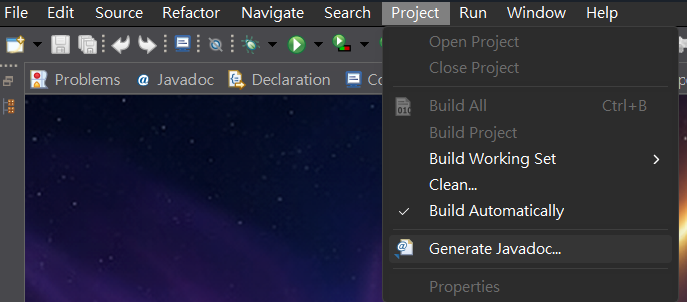

# Week 5｜Java 物件導向課堂筆記

- **上課日期：**2026/10/13
- **講義一：**《Encapsulation》，Tessema Mengistu, Ph.D.；已整理 p.1–p.13。
- **講義二：**《Classes and Objects》（檔案 `4_Classes_And_Objects.pdf`）；已整理 p.41 Method Overloading、p.44–p.46 Math 類別、p.47–p.57 Wrapper 類別與應用；p.42–p.43 尚未整理。
- **講義三：**《Command Line Arguments, Packages, and JavaDoc》（檔案 `6_CLA_Packages_JavaDoc.pdf`）；正文 p.3–p.18 與 p.19 參考資料已整理完成，含課堂問答及操作圖片。
- **可執行的範例程式：**[`../src/`](../src)（Hello、Sum、StaticCalculator、InstanceCalculator）
- **筆記方式：**先記錄老師的開場問題，再依講義頁碼整理；補充範例另行標示。

## 一、老師的開場問題

### Q1：`private` and `public`？

`private` 和 `public` 是 **access modifiers（存取修飾詞）**，用來控制哪些程式碼可以存取欄位或方法。

| 修飾詞 | 存取範圍 | 初學記憶方式 |
|---|---|---|
| `public` | 其他類別也可以存取，前提是所屬類別本身可被存取 | 對外開放 |
| `private` | 一般情況下，只有宣告它的類別內部可以直接存取 | 類別內部使用 |

```java
class Student {
    public String name; // 外部可直接讀取與修改
    private int age;    // 外部不可直接讀取與修改
}
```

**連結前面學過的 instance variable：**

```java
private int age;
```

- `private`：描述「誰可以存取」。
- 沒有 `static`：這裡宣告的欄位是 **instance variable（實例變數）**，每個 `Student` 物件各有一份。

因此，**instance variable 可以是 `private`，也可以是 `public`**；兩者描述的是不同面向。

### 開場補充：private — modified within the class

課堂速記：「private: modified within the classes」。在目前討論一般類別的情境下，更精確的說法是：

> **A private member can be accessed directly only within the class that declares it.**
> `private` 成員只能在宣告它的類別內直接存取。

- **Access（存取）**包含讀取與修改，不只是修改。
- 這裡強調的是 **the class that declares it**，不是任意其他類別。
- 外部仍可呼叫 `public` 方法，讓類別內部的程式碼間接讀取或修改資料。
- 補充精確規則：Java 中，同一個頂層類別所包住的巢狀類別也可以互相存取 `private` 成員；目前先以一般、非巢狀類別的例子理解。

```java
class Car {
    private int speed;

    public void setSpeed(int value) {
        if (value >= 0) {
            speed = value; // 在宣告 speed 的 Car 類別內修改
        }
    }
}
```

在另一個一般類別的方法中：

```java
Car tesla = new Car();
// tesla.speed = 100; // 不允許：外部直接存取 private 欄位
tesla.setSpeed(100);  // 允許：由 Car 內部的方法修改
```

此處的簡化 `Car` 範例獨立於後面的車子範例。

### Q2：The data is hidden by class，資料只能用 method 讀取和修改嗎？

**就這堂課介紹的封裝方式而言，是的：把資料欄位設為 `private`，外部程式就必須透過物件提供的可存取方法來操作資料。**

需要分清楚：

- **類別外部：**不能直接讀寫 `private` 欄位。
- **類別內部：**可以直接讀寫自己的 `private` 欄位。
- **是否開放操作：**由類別提供的方法決定；不一定允許外部取得或修改每一項資料。

> 不是「資料放進 class 就自動隱藏」，而是透過 `private` 等存取限制實現資料隱藏（data hiding）。

## 二、講義 p.1｜Encapsulation

本週主題是 **Encapsulation（封裝）**。

先抓住核心：**物件把自己的資料保護起來，並透過方法管理外部可以進行的操作。**

## 三、講義 p.2｜Outline（課程大綱）

這份講義列出兩個主題：

1. **Encapsulation（封裝）**
2. **Accessors and Mutators（讀取與修改資料的方法）**

目前整理到 p.13，已介紹 Accessors、Mutators、常數，以及封裝前後的程式碼對照；補充範例另有標示。

## 四、講義 p.3｜OOP Concepts

**OOP = Object-Oriented Programming（物件導向程式設計）**。

講義列出三個重要概念：

| 英文 | 中文 | 本次進度 |
|---|---|---|
| Encapsulation | 封裝 | 本週開始介紹 |
| Inheritance | 繼承 | 本頁列出名稱，尚未展開 |
| Polymorphism | 多型 | 本頁列出名稱，尚未展開 |

## 五、講義 p.4｜Encapsulation 的核心

### 1. Hiding the data within a class

**將資料隱藏在類別內部。**

在本課的 Java 範例中，可以用 `private` 欄位達成，讓外部程式不能隨意直接讀取或修改資料。

### 2. Making it available only through the methods

**透過方法提供資料的存取或操作。**

方法是外部使用物件的介面。類別可以決定允許哪些操作，也可以在方法裡檢查輸入是否合理。

```text
外部程式
    │
    │ 呼叫物件提供的方法
    ▼
┌─────────────────────────┐
│ 物件                    │
│   Methods（方法）       │
│       │ 管理與檢查      │
│       ▼                 │
│   Data（內部資料）      │
└─────────────────────────┘
```

**講義圖示重點：**Methods 與 Data 都放在物件內部；外部連線接到 Methods，再由 Methods 與 Data 互動，表示外部透過方法操作內部資料。

### 3. Each object protects and manages its own data

**每個物件保護並管理自己的資料。**

講義將這種特性稱為 **self-governing（自我管理）**。

意思是：物件透過自己所屬類別定義的方法，管理內部資料的讀取與更新規則。例如，學生物件可以要求年齡不能小於 0。

> **封裝的重點：由物件管理自己的資料，讓外部透過受控制的方法與它互動。**

## 六、講義 p.5｜Why Encapsulation?（為什麼需要封裝？）

### 1. 隱藏內部實作，方便日後修改

**Internal implementation details（內部實作細節）**包含資料如何儲存、組織，以及方法內部如何完成操作。

封裝讓 client code 透過對外介面使用物件，而不直接依賴內部細節。因此，當內部實作改變，只要對外介面及其約定行為維持相容，client 就不必跟著修改。

**連結車子的例子：**`Car` 可以調整內部儲存速度的方式，外部仍然使用 `tesla.setSpeed(100)`。

### 2. 防止不小心或刻意的不當操作

講義提到 accidental or willful mistakes，指避免外部程式不小心或刻意以不適當的方式操作類別。

例如，將 `speed` 設為 `private`，並在 `setSpeed()` 中檢查輸入，就能防止外部繞過這個方法直接設定不符合規則的值。

**補充：**只有把欄位設成 `private`，不會自動檢查值是否合理；檢查規則仍須寫在方法或建構子內。

### 3. 將 Implementation 與 Interface 分開

| 名詞 | 意思 | 車子的例子 |
|---|---|---|
| Interface | 對外提供哪些操作，以及怎麼使用 | `setSpeed(int)`、`getSpeed()` |
| Implementation | 內部如何完成這些操作 | 速度存在哪個欄位、如何檢查及更新 |

講義在此帶出 **Data Abstraction（資料抽象化）**：使用者透過必要的操作理解及使用資料，不必掌握背後所有實作細節。

> **Interface：外部怎麼用。Implementation：內部怎麼做。**

## 七、講義 p.6｜Visibility Modifiers（存取修飾詞）

講義指出：透過 visibility modifiers 控制存取範圍，可以實現封裝中的資料隱藏。

### 本週重點：public 與 private

| 修飾詞 | 講義關鍵字 | 意思 |
|---|---|---|
| `public` | least restrictive | 限制最少，外部類別可以存取公開成員，前提是所屬類別可被存取 |
| `private` | most restrictive | 限制最多，一般外部類別不能直接存取，供宣告它的類別內部使用 |

**Instance data should be defined private.**

這是本課的設計建議：**將實例資料設為 `private`，再透過適當的方法提供操作。** 這不是說 Java 語法禁止宣告 `public` 實例變數。

```java
private int speed; // 保護物件的內部資料
```

### 下週再展開的項目

本頁也列出 Package-default 與 Protected；依老師的課堂安排，本週只記錄名稱，詳細範圍與用法留到下週。

- **Package-default：**未寫存取修飾詞，也稱 package-private。
- **Protected：**使用 `protected` 修飾詞。

> **本週記法：資料通常設為 private，需要對外開放的操作透過 public 方法提供。**

## 八、講義 p.7｜Using Set and Get Methods

### 1. 外部如何操作 private 資料？

外部不能直接讀寫 `private` 欄位，但可以呼叫類別對外提供的 **set 與 get methods**，由類別內部的程式碼存取資料。

### 2. Set Method：Setter／Mutator

- 通常是供外部呼叫的 `public` 方法，用來設定或修改 `private` 欄位。
- 又稱 **mutator method**，重點是「改變值」。
- 類別決定開放修改哪些資料，也可以在更新前驗證輸入。

```java
public void setSpeed(int value) {
    if (value >= 0) {
        speed = value;
    }
}
```

### 3. Get Method：Getter／Accessor／Query

- 通常是供外部呼叫的 `public` 方法，用來取得類別願意提供的資料。
- 又稱 **accessor method** 或 **query method**，重點是「查詢或讀取」。
- 類別決定對外提供哪些資訊。

```java
public int getSpeed() {
    return speed;
}
```

**用語釐清：**講義用 displays 描述 get method；一般 getter 是**回傳資料**，不一定直接把資料印在畫面上。

```java
int currentSpeed = tesla.getSpeed(); // getter 回傳值
System.out.println(currentSpeed);   // println 才負責顯示
```

以上 set/get 方法片段是補充示例，放在具有 `private int speed` 欄位的 `Car` 類別中；呼叫片段放在 client 的方法中。

### 4. 為什麼不違反 private？

```text
外部直接存取欄位：tesla.speed = 100;    不允許
外部呼叫公開方法：tesla.setSpeed(100);  允許
```

第二種情況中，**真正修改 `speed` 的程式碼位於 `Car` 內部**，所以沒有違反 `private` 的存取限制。

| 方法 | 別名 | 主要用途 | 此範例的回傳型別 |
|---|---|---|---|
| `setSpeed(int value)` | Setter／Mutator | 設定或修改資料 | `void` |
| `getSpeed()` | Getter／Accessor／Query | 取得資料 | `int` |

**補充：**不必為每個欄位都提供 getter 和 setter；`get`、`set` 是命名慣例，不是 Java 關鍵字。

> **Set 改值，Get 取值；資料仍由 class 內部管理。**

## 九、講義 p.8｜Constants（常數）可以公開

講義重點：**常數的值不能被修改，因此可以接受將常數設為 `public`。**

這與「一般實例資料通常設為 `private`」不衝突：需要保護可變資料，與對外提供固定數值，是不同情況。

以下為補充範例：

```java
public static final double PI = 3.14;
```

| 關鍵字 | 此範例中的用途 |
|---|---|
| `public` | 外部可以讀取這個常數 |
| `static` | 屬於類別，所有物件共用，不必每個圓存一份 |
| `final` | 初始化後不能重新指派值 |
| `double` | 可儲存小數的型別 |
| `PI` | 常數名稱通常使用大寫；`3.14` 是本例指定的近似值 |

若宣告在 `Circle` 內，可以用 `Circle.PI` 讀取；`Circle.PI = 3.14159;` 則會編譯失敗。

**補充：**使變數不能重新指派的是 `final`，不是 `static`。如果 `final` 變數保存的是可變物件或陣列的參考，並不代表其內容也不能變；此處的 `PI` 是基本型別 `double` 常數。

## 十、講義 p.9–p.13｜封裝前後對照表

### 1. 頁面對照

| 頁碼 | 主題 | 要觀察的重點 |
|---|---|---|
| p.9 | Without Encapsulation：`Person` | `firstName`、`lastName`、`age` 未設為 `private`；提供 `display()` |
| p.10 | Without Encapsulation：`PersonTest` | Client 直接修改欄位，甚至可將 `age` 設為 `-21` |
| p.11 | With Encapsulation：`Person` | 三個欄位改成 `private`，並提供姓名的讀取及設定方法 |
| p.12 | With Encapsulation：接續 `Person` | 提供 `getAge()`、`setAge()`；設定負年齡時印出訊息，並把年齡設為 `0` |
| p.13 | With Encapsulation：`PersonTest` | Client 不能直接存取 `private` 欄位，改呼叫公開方法 |

**範圍提醒：**p.9 的欄位沒有寫修飾詞，是 package-private，並不是 `public`。p.10 的直接存取以兩個類別位於同一個 package 為前提；完整存取範圍留待下週。

### 2. 設計與行為對照

以下方法名稱已統一為一致的 camelCase，講義原稿的拼字問題列在後面。

| 比較項目 | 未封裝：p.9–p.10 | 有封裝：p.11–p.13 |
|---|---|---|
| 年齡欄位 | `int age;` | `private int age;` |
| 姓名欄位 | `String firstName;`、`String lastName;` | `private String firstName;`、`private String lastName;` |
| Client 設定年齡 | `p1.age = 20;` | `p1.setAge(20);` |
| Client 讀取年齡 | 同 package 可用 `p1.age` | 使用 `p1.getAge()` |
| 設定不合理年齡 | `p1.age = -21;`，欄位直接變成 `-21` | `p1.setAge(-21);`，印出 `wrong age`，欄位變成 `0` |
| 資料規則由誰控制 | Client 可直接賦值，沒有集中檢查 | `Person` 的 `setAge()` 統一檢查 |
| 姓名操作 | 直接存取欄位 | 透過 `setFirstName()`、`setLastName()` 等方法 |
| 對內部資料的依賴 | Client 依賴欄位名稱及表示方式 | Client 主要依賴公開方法及其約定行為 |
| 更改內部實作 | 可能需要修改直接使用欄位的 client | 對外介面及行為維持相容時，client 可維持原樣 |

### 3. Client 操作結果對照

| Client 程式碼 | 未封裝版本（同 package） | 有封裝版本 |
|---|---|---|
| `p1.age = 20;` | 可以直接修改 | 編譯錯誤：`age` 是 `private` |
| `p1.age = -21;` | 可以直接修改，得到不合理的值 | 編譯錯誤：不能直接存取 |
| `p1.setAge(20);` | 原版沒有此方法 | 允許，年齡變成 `20` |
| `p1.setAge(-21);` | 原版沒有此方法 | 允許呼叫，但依方法規則印出 `wrong age`，年齡設為 `0` |
| `p1.lastName = "John";` | 可以直接修改 | 編譯錯誤：`lastName` 是 `private` |
| `p1.setFirstName("John");` | 原版沒有此方法 | 統一方法拼字後，可透過公開 setter 修改 |
| `p1.setLastName("Smith");` | 原版沒有此方法 | 統一方法拼字後，可透過公開 setter 修改 |

表中的各行是分別比較。若將編譯錯誤的行保留在實際程式中，整份程式不會成功編譯，必須先刪除或註解那些行。

### 4. p.12 年齡檢查：整理後的正確括號

```java
public void setAge(int age) {
    if (age < 0) {
        System.out.println("wrong age");
        this.age = 0;
    } else {
        this.age = age;
    }
}
```

| 寫法 | 代表什麼 |
|---|---|
| `int age` | 呼叫者傳入的方法參數 |
| `this.age` | 目前這個 `Person` 物件的實例變數 |
| `this.age = age;` | 將傳入的值存入目前物件的欄位 |

**注意：**本講義遇到負年齡會「改成 `0`」，不是「保留原值」。前面補充範例遇到負數則不更新；這是兩種不同的驗證策略。封裝讓類別能決定策略，但不會自動決定策略。

### 5. 講義原稿的拼字與語法提醒

以下是核對投影片後整理的問題，避免將拼字錯誤誤認成封裝的效果。

| 頁碼 | 原稿問題 | 筆記採用的修正或說明 |
|---|---|---|
| p.10 | `firstname` 與 p.9 的 `firstName` 不同 | 統一為 `firstName`；Java 區分大小寫 |
| p.10、p.13 | `dispaly()` | 應為 `display()` |
| p.11 | `getfirsName()`、`getlastName()`、`setfirstName()` | 統一為 `getFirstName()`、`getLastName()`、`setFirstName()`，並讓呼叫端一致 |
| p.12 | `setlastName()` 與 p.13 的 `setLastName()` 不同 | 統一為 `setLastName()` |
| p.12 | `else` 前缺少關閉 `if` 區塊的 `}` | 使用上方整理後的括號結構 |
| p.13 | 封裝版的 p.11–p.12 沒有展示 `display()` 定義 | 若要呼叫，須在封裝版 `Person` 補上適當可見的 `display()`，或改用 getter 取得資料後印出 |

**姓名內容提醒：**p.10 將 `lastName` 設為 `John`、`firstName` 設為 `Smith`；p.13 則以 `John` 為 first name、`Smith` 為 last name。這是範例賦值差異，不是封裝自動交換姓名。

> **沒有封裝：Client 直接改欄位。有封裝：Client 呼叫方法，由類別控制資料規則。**

## 十一、課堂例子｜封裝 Circle：PI、radius、area()、circum()

本節是使用者提出的圓形補充範例，並非講義原有程式碼。依題目使用 `PI = 3.14`。

### 1. 各成員如何設計？

| 成員 | 宣告方式 | 原因 |
|---|---|---|
| `PI` | `public static final double` | 固定常數，可以公開讀取，所有圓共用 |
| `radius` | `private double` | 每個圓自己的可變資料，避免外部直接改動 |
| `setRadius()` | `public void` | 提供設定半徑的入口，並檢查值 |
| `getRadius()` | `public double` | 允許外部讀取半徑 |
| `area()` | `public double` | 回傳面積：πr² |
| `circum()` | `public double` | 回傳周長：2πr |

### 2. Circle 類別

```java
public class Circle {
    public static final double PI = 3.14;
    private double radius;

    public void setRadius(double radius) {
        if (radius >= 0) {
            this.radius = radius;
        } else {
            System.out.println("Radius must be non-negative");
        }
    }

    public double getRadius() {
        return radius;
    }

    public double area() {
        return PI * radius * radius;
    }

    public double circum() {
        return 2 * PI * radius;
    }
}
```

存為 `Circle.java`。在這個教學範例中，半徑可為 `0`；新物件的 `radius` 預設是 `0.0`。輸入負數會印出訊息並保留原半徑，與講義 `setAge()` 的「改成 0」策略不同。

### 3. Client 使用方式

以下放在另一個類別的 `main` 方法內：

```java
Circle c = new Circle();
c.setRadius(5);

System.out.println(Circle.PI);    // 3.14
System.out.println(c.getRadius()); // 5.0
System.out.println(c.area());      // 78.5
System.out.println(c.circum());    // 約 31.4，浮點輸出可能有尾差

// c.radius = 10; // 編譯錯誤：radius 是 private
// Circle.PI = 3; // 編譯錯誤：PI 是 final，不能重新指派

c.setRadius(10); // 正確：經過公開方法設定
```

### 4. 為什麼不另外存 area 與 circumference？

面積與周長可以由半徑算出，這個例子不必再存成欄位。每次呼叫 `area()`、`circum()` 都使用目前半徑計算，避免「半徑已改，儲存的面積卻忘了更新」。

`area()`、`circum()` 也說明：**封裝不只有 getter／setter，還可以提供有意義的計算與操作。** 外部不必直接碰 `radius` 就能取得結果。

> **PI 公開但不能改；radius 隱藏並由方法管理；area()、circum() 對外提供計算結果。**

## 十二、補充範例｜把開場問題與 p.4 連起來

以下為課堂概念的補充程式碼，並非講義 p.1–p.4 原有的程式碼。

```java
class Student {
    private int age; // 隱藏資料；每個物件各有自己的一份

    public int getAge() {
        return age; // 由方法提供讀取
    }

    public void setAge(int value) {
        if (value >= 0) {
            age = value; // 檢查通過才更新
        }
    }
}

public class Main {
    public static void main(String[] args) {
        Student s = new Student();

        // s.age = 20;                  // 編譯錯誤：不能直接修改
        // System.out.println(s.age);   // 編譯錯誤：不能直接讀取

        s.setAge(20);                   // 透過方法修改
        System.out.println(s.getAge()); // 印出 20

        s.setAge(-5);                   // 不符合條件，不更新
        System.out.println(s.getAge()); // 仍印出 20
    }
}
```

這份完整範例可儲存為 `Main.java`。

| 程式碼 | 對應概念 |
|---|---|
| `private int age` | Data hiding：限制外部直接存取資料 |
| `public int getAge()` | 提供外部讀取資料的方法，通常稱為 getter／accessor |
| `public void setAge(int value)` | 提供外部修改資料的方法，通常稱為 setter／mutator |
| `if (value >= 0)` | 物件透過方法檢查資料，體現 self-governing |

**不一定每個欄位都需要 getter 和 setter。** 類別可以只提供讀取方法，或提供特定操作，而不開放直接設定資料的值。

## 十三、課堂問答補充｜修改資料、資料結構與車子的例子

**提問：**「modified data、data structure？以車為例，class 與 Sheron 車、Tesla 的關係？」

以下先把問題理解為「修改資料和修改內部資料結構有什麼不同」，並把 Sheron 與 Tesla 當成兩台具體的車來示範。這是概念補充，並非新增講義頁面的摘要。

### 1. Class 與兩台車

```java
class Car {
    private String name;
    private int speed;

    public Car(String name) {
        this.name = name;
    }

    public void setSpeed(int value) {
        if (value >= 0) {
            speed = value;
        }
    }

    public int getSpeed() {
        return speed;
    }
}
```

以下操作放在另一個類別的 `main` 方法中：

```java
Car sheron = new Car("Sheron");
Car tesla = new Car("Tesla");

sheron.setSpeed(60);
tesla.setSpeed(80);

System.out.println(sheron.getSpeed()); // 60
System.out.println(tesla.getSpeed());  // 80

// tesla.speed = 100; // 編譯錯誤：speed 是 private
tesla.setSpeed(100);  // 透過方法修改 Tesla 物件的資料
```

| 名稱 | 此範例中的角色 |
|---|---|
| `Car` | Class：定義車子有哪些資料及操作 |
| 兩次 `new Car(...)` 建立的物件 | 兩個不同的 instances／objects：兩台具體的車 |
| `sheron`、`tesla` | Reference variables：分別指向兩台車 |
| `name`、`speed` | Instance variables：每台車各有自己的資料 |
| `setSpeed()`、`getSpeed()` | Methods：管理資料的修改與讀取 |

**品牌或車型名稱本身不等於 instance。** 這裡用名稱標記兩台實際的車；也可以依程式需求把 `Tesla` 設計成一個類別，但那是另一種建模方式。

### 2. 修改 Data 與修改 Data Structure

| 概念 | 意思 | 車子的例子 |
|---|---|---|
| 修改資料（modify data） | 改變某個物件目前保存的值 | 將 Tesla 的 `speed` 從 `80` 改成 `100` |
| 修改內部資料表示／結構 | 改變程式如何儲存或組織資料 | 原本直接存一個 `speed` 欄位，後來改由內部的狀態物件保存速度與其他車況 |

`Data structure` 通常指資料的組織方式，例如陣列、串列、映射等；單純改變速度數值不算更換資料結構。封裝情境中，也常討論更廣義的「內部資料表示方式」。

假設 `Car` 內部改了儲存速度的方式，只要仍維持 `setSpeed(int)`、`getSpeed()` 的使用方式與對外行為，外部就可以繼續寫：

```java
tesla.setSpeed(100);
System.out.println(tesla.getSpeed());
```

外部不必知道資料實際存在哪裡。**封裝的好處之一，就是降低外部程式對內部資料表示方式的依賴。**

> **改 data：改車速的值。改內部結構：改車速怎麼存。封裝：讓外部透過方法操作，不必知道裡面怎麼存。**

## 十四、課堂問答補充｜Interface、API Calls 與 Client Code

**課堂關鍵字紀錄：**interface、methods／API calls、intact、修改背後的資料結構、client 端。

依這段討論的語境，可以整理為：**只要對外介面及其約定行為保持相容，類別就可以修改內部資料結構，而不必讓使用它的 client code 跟著修改。**

### 1. Interface 是什麼？

這裡的 **interface（介面）** 指類別對外提供的使用方式，主要是外部可以呼叫的方法，以及方法的參數、回傳值與約定行為。

- **API（Application Programming Interface）**：程式提供給其他程式使用的介面。
- **API call／method call**：實際呼叫介面中某個方法的動作。
- 此處的 interface 是一般概念，**不一定指 Java 的 `interface` 關鍵字**。
- API 呼叫也不一定是網路請求；呼叫同一個 Java 程式裡的物件方法，也是在使用該類別的 API。

```java
// Car 對外提供的方法
public void setSpeed(int value)
public int getSpeed()
```

上面是方法宣告的示意，省略方法內容；下面才是實際的方法呼叫：

```java
tesla.setSpeed(100);
int currentSpeed = tesla.getSpeed();
```

### 2. Client 端是誰？

**Client code 是「使用這個類別或服務的程式碼」。** 在這個例子裡，呼叫 `Car` 方法的 `main` 方法、其他類別或其他方法，都可以是 `Car` 的 client。

這裡不一定涉及瀏覽器、前端或另一台電腦；client 描述的是「使用者／呼叫者」的角色。

```text
Client code（使用 Car 的程式碼）
    │
    │ tesla.setSpeed(100)
    ▼
Car 的對外介面（public methods）
    │
    ▼
Car 的內部實作與 private 資料
```

### 3. Intact：哪些部分要保持不變？

**Intact** 在這裡可以理解為「維持原有的使用方式，沒有被破壞」。

例如 `Car` 內部原本用一個 `speed` 欄位存速度，後來改成使用內部的車況物件。只要仍提供相容的 `setSpeed(int)`、`getSpeed()`，而且速度的單位、設定與讀取的意義等約定行為不變，client 原本的呼叫就可以繼續使用。

| 部分 | 在此例中是否需要跟著改？ |
|---|---|
| `Car` 的內部資料結構 | 可以修改 |
| `Car` 方法內部的實作 | 可能需要調整，以配合新結構 |
| Client 的 `tesla.setSpeed(100)` 呼叫 | 對外介面和約定行為維持相容時，不必修改 |

**不能只保留方法名稱。** 如果參數、回傳型別或約定行為改變，client 仍可能受影響。例如把速度單位從 km/h 改成 mph，即使方法名稱相同，使用結果也不同。

> **Client 知道「怎麼呼叫」；class 負責「裡面怎麼做」。封裝讓內部能改，而外部的使用方式可以維持不變。**

## 十五、本次記憶重點

| 關鍵字 | 要記住的意思 |
|---|---|
| `public` | 對外開放存取 |
| `private` | 限制外部直接存取 |
| Data hiding | 把內部資料隱藏並保護起來 |
| Encapsulation | 將資料與相關操作組織在物件中，控制外部如何使用資料 |
| Methods | 提供操作資料的介面，並可加入檢查規則 |
| Self-governing | 每個物件保護並管理自己的資料 |
| Interface／API | 對外提供的操作與使用規則 |
| Implementation | 內部如何儲存資料及完成操作 |
| Data Abstraction | 透過必要操作使用資料，不必了解全部內部細節 |
| Setter／Mutator | 設定或修改資料的方法 |
| Getter／Accessor／Query | 取得或查詢資料的方法 |
| `final` 常數 | 初始化後不能重新指派；基本型別常數可公開讀取 |
| `this.age` | 目前物件的 `age` 欄位，可與同名參數區分 |

> **資料藏在裡面，外部透過方法操作，物件自己管理規則。**

---

## 十六、下週預告

- `protected`
- Default access（未寫存取修飾詞，也稱 package-private）

老師註記：以上兩種存取範圍下週再講，本週先不展開。

**《Encapsulation》目前記錄至 p.13；p.14 尚未整理。依課堂安排，接著切換至《5_Classes_And_Objects》p.41。**

---

## 十七、下一節課｜Method Overloading（方法多載）

**新講義：**《5_Classes_And_Objects》p.41。以下切換至新講義的頁碼。

### 1. 什麼是 Method Overloading？

**使用相同的方法名稱，但定義不同的參數型別列表。** 這些方法通常用來完成相似的工作，讓呼叫者能提供不同形式的輸入。

| 如何區分多載方法 | 方法簽章示例 | 差異 |
|---|---|---|
| 參數數量 | `area(double)` 與 `area(double, double)` | 一個參數、兩個參數 |
| 參數型別 | `print(int)` 與 `print(String)` | 整數、字串 |
| 參數型別順序 | `show(String, int)` 與 `show(int, String)` | 第一個與第二個參數的型別順序不同 |

上述僅列出簽章，並非完整的方法宣告。**順序指的是型別順序**；把兩個 `double` 參數的名稱交換，仍然是 `(double, double)`，不會形成新的多載。

### 2. 課堂提問：Signature 是什麼？

**Method signature（方法簽章）**是 Java 辨認方法時使用的資訊。在本課的一般、非泛型方法中，可記為：

> **方法簽章 = 方法名稱 + 依序排列的參數型別。**

例如：

```java
public double area(double radius) {
    return 3.14 * radius * radius;
}
```

| 宣告片段 | 意義 | 屬於本例的 signature 嗎？ |
|---|---|---|
| `public` | 存取修飾詞 | 否 |
| 第一個 `double` | 回傳型別 | 否 |
| `area` | 方法名稱 | 是 |
| 括號內的 `double` | 參數型別 | 是 |
| `radius` | 參數名稱 | 否 |

因此簽章是 **`area(double)`**。

### 3. 為什麼只改回傳型別或參數名稱不行？

以下是方法宣告的示意，省略方法內容：

```java
double area(double radius)
int area(double radius)
```

兩者簽章都是 `area(double)`；**不能在同一個類別中靠不同回傳型別定義這兩個方法**，否則會發生編譯錯誤。

同樣地，`area(double radius)` 和 `area(double r)` 的簽章相同，單純換參數名稱不構成多載。

### 4. 補充範例：面積計算的多載

以下兩個方法可放在同一個類別中：

```java
public double area(double radius) {
    return 3.14 * radius * radius; // 圓面積
}

public double area(double width, double height) {
    return width * height;        // 長方形面積
}
```

| 呼叫示例 | 對應簽章 | 結果 |
|---|---|---|
| `area(5.0)` | `area(double)` | 圓面積：`78.5` |
| `area(5.0, 3.0)` | `area(double, double)` | 長方形面積：`15.0` |

這是多載的獨立教學範例；與前一節 `Circle` 使用物件內部半徑的 `area()` 不同。無參數的 `area()` 本身也是一個不同簽章。

### 5. Java 如何選擇要呼叫哪一個方法？

講義指出，Java 依照呼叫時 arguments 的數量、型別與順序選擇適合的方法。此處的多載選擇發生在**編譯期**；若沒有適用方法，或無法唯一選出最合適的方法，就會編譯失敗。

| 名詞 | 出現位置 | 例子 |
|---|---|---|
| Parameter（參數） | 方法宣告 | `double radius` |
| Argument（引數） | 呼叫方法時提供 | `area(5.0)` 裡的 `5.0` |

講義使用 `println` 作為多載的例子：

```java
System.out.println(5);       // 使用 int 版本
System.out.println(3.14);    // 使用 double 版本
System.out.println("Hello"); // 使用 String 版本
```

> **Overloading：同名方法，不同參數型別列表。Signature 不包含回傳型別，也不包含參數名稱。**

### 6. 課堂問答：為什麼 sum() 要加 static？

以下兩個方法的參數型別順序不同，**不加 `static` 也可以構成多載**：

```java
public float sum(int num1, float num2) {
    return num1 + num2;
}

public float sum(float num1, int num2) {
    return num1 + num2;
}
```

它們的簽章分別是 `sum(int, float)` 和 `sum(float, int)`。

**加上 `static` 通常是呼叫方式的需要，而不是多載的要求。** 若呼叫端位於 `public static void main(String[] args)`，並希望直接寫 `sum(...)`，就可以將要這樣呼叫的方法宣告成 `static`。

| 宣告方式 | 方法屬於誰 | 從 `static main()` 如何使用 |
|---|---|---|
| `public float sum(...)` | 物件的實例方法 | 先建立物件，再用 `物件.sum(...)` 呼叫 |
| `public static float sum(...)` | 類別的靜態方法 | 用 `類別.sum(...)`；同一類別內可直接寫 `sum(...)` |

**做法 A：兩個多載版本都使用 static。**

```java
public class Calculator {
    public static float sum(int num1, float num2) {
        return num1 + num2;
    }

    public static float sum(float num1, int num2) {
        return num1 + num2;
    }

    public static void main(String[] args) {
        System.out.println(sum(2, 3.5f)); // sum(int, float)
        System.out.println(sum(2.5f, 3)); // sum(float, int)
    }
}
```

**做法 B：保留實例方法，建立物件後呼叫。** 若將上例兩個 `sum` 宣告中的 `static` 移除，`main` 的內容改為：

```java
Calculator c = new Calculator();
System.out.println(c.sum(2, 3.5f));
System.out.println(c.sum(2.5f, 3));
```

`main` 是靜態方法，不會自動有一個 `Calculator` 物件可以拿來呼叫實例方法；但它可以自行建立物件，再透過該物件呼叫。

**呼叫時的小提醒：**`3.5f` 是 `float`；直接寫 `3.5` 則是 `double`。在只有這兩個多載版本時，`sum(2, 3)` 會有歧義：兩個版本都需要將一個 `int` 轉成 `float`，沒有唯一較合適的版本。

> **Overloading 決定「用哪個參數版本」；static 決定方法屬於類別，呼叫時不需要先建立物件。static 本身不能用來區分同簽章的方法。**

這是依使用者提供的宣告所作的補充；尚未看到要求修改的完整呼叫端，因此「為了從 main 直接呼叫」是常見原因，而非已確認的原始程式情況。

### 7. 完整程式對照：沒有 static 與有 static

兩份程式可分別執行，檔名必須與 public class 名稱一致。兩個版本都保留 sum(int, float) 與 sum(float, int) 的多載。

**版本 A：InstanceCalculator.java。不加 static，先建立物件。**

```java
public class InstanceCalculator {
    // No static: call these methods through an object.
    public float sum(int num1, float num2) {
        return num1 + num2;
    }

    public float sum(float num1, int num2) {
        return num1 + num2;
    }

    public static void main(String[] args) {
        InstanceCalculator calculator = new InstanceCalculator();

        float result1 = calculator.sum(2, 3.5f);
        float result2 = calculator.sum(2.5f, 3);

        System.out.println(result1); // 5.5
        System.out.println(result2); // 5.5
    }
}
```

`new InstanceCalculator()` 建立一個物件，`calculator` 保存它的參考。接著用 `calculator.sum(...)` 呼叫這個物件的方法。

**版本 B：StaticCalculator.java。加上 static，透過類別呼叫。**

```java
public class StaticCalculator {
    // Static: call these methods through the class.
    public static float sum(int num1, float num2) {
        return num1 + num2;
    }

    public static float sum(float num1, int num2) {
        return num1 + num2;
    }

    public static void main(String[] args) {
        float result1 = StaticCalculator.sum(2, 3.5f);
        float result2 = StaticCalculator.sum(2.5f, 3);

        System.out.println(result1); // 5.5
        System.out.println(result2); // 5.5
    }
}
```

這裡不需要 `new StaticCalculator()`，直接以類別名稱 `StaticCalculator.sum(...)` 呼叫。同一類別的 main 裡，也可以省略類別名稱寫成 `sum(...)`。

兩份程式各自的輸出相同：

```text
5.5
5.5
```

| 要看的地方 | 沒有 static | 有 static |
|---|---|---|
| 宣告 | `public float sum(...)` | `public static float sum(...)` |
| 建立物件 | `new InstanceCalculator()` | 不需要 |
| 呼叫方式 | `calculator.sum(...)` | `StaticCalculator.sum(...)` |
| 是否可以多載 | 可以 | 可以 |

`3.5f`、`2.5f` 的 `f` 表示 float。兩個方法的參數型別順序不同，所以分別對應 `(int, float)` 與 `(float, int)`。

**先記呼叫方式：沒有 static，透過物件呼叫；有 static，可以透過類別呼叫。不是為了多載才必須加 static。**

## 十八、講義 p.44–p.46｜Math 類別：靜態方法與常數（濃縮）

**`Math` 是 Java 內建的數學工具類別，位於 `java.lang` package，不必另外 import。** 本節的方法都是 `static`，直接寫 `Math.方法(...)`，不需要建立物件；這就是前面「透過類別呼叫靜態方法」的實際例子。

講義 p.45 的「Package java.lang.Math」用語應釐清：package 是 `java.lang`，`Math` 是其中的 class。

| 功能 | 寫法 | 結果／重點 |
|---|---|---|
| 絕對值 | `Math.abs(-5)` | `5`（p.44 提及功能，此為補充例子） |
| 次方 | `Math.pow(2, 3)`／`Math.pow(3, 2)` | `8.0`／`9.0` |
| 平方根 | `Math.sqrt(36)` | `6.0` |
| 自然對數，以 e 為底 | `Math.log(1000)` | 約 `6.9078` |
| 以 10 為底的對數 | `Math.log10(1000)` | `3.0` |
| 取較大值 | `Math.max(54, 70)` | `70` |
| 取最接近的整數 | `Math.round(3.14159)` | `3`；此例傳入 `double`，回傳 `long` |
| 正弦 | `Math.sin(Math.toRadians(90))` | `1.0`；先把 90 度轉成弧度 |
| 偽隨機數 | `Math.random()` | 回傳 `double`，範圍 `0.0 <= 值 < 1.0`，結果不固定 |

**三角函數使用弧度（radians），不是角度（degrees）。** `Math.sin(90)` 計算的是 90 弧度的正弦，約為 `0.894`；要算 90 度，必須先用 `Math.toRadians(90)` 轉換。

**兩個內建常數都是 `public static final double`：**

| 常數 | 意義 | 近似值 |
|---|---|---|
| `Math.PI` | 圓周率 π：圓周長與直徑的比值 | `3.141592653589793` |
| `Math.E` | 自然對數的底數 e | `2.718281828459045` |

常數是欄位，使用時**不加括號**：`Math.PI`；方法則加括號：`Math.sqrt(36)`。這些常數是有限精度的 `double` 近似值，不能重新指派。

**連結圓的例子（以下片段放在方法內）：**

```java
double radius = 5;
double area = Math.PI * radius * radius;
double circumference = 2 * Math.PI * radius;
```

原先題目指定 `PI = 3.14`，此處改用內建的 `Math.PI`，可取得更精確的圓周率近似值。

> **Math 方法直接用類別呼叫；三角函數先確認弧度；PI／E 是常數，不加括號。**

## 十九、講義 p.47–p.48｜Wrapper Classes（包裝類別）

**Wrapper class 將基本型別的值以物件形式表示，讓資料可以用在需要物件的地方。** 例如：`int` 是基本型別，`Integer` 是對應的包裝類別。以下包裝類別都位於 `java.lang`，不必另外 import。

| Primitive type（基本型別） | Wrapper class（包裝類別） |
|---|---|
| `byte` | `Byte` |
| `short` | `Short` |
| `int` | `Integer` |
| `long` | `Long` |
| `float` | `Float` |
| `double` | `Double` |
| `char` | `Character` |
| `boolean` | `Boolean` |

**特別記：**`int → Integer`、`char → Character`，不是只把第一個字母改成大寫。

講義另列 `void → Void`：這是特殊情況。`void` 表示方法不回傳值，不是第九種基本資料型別；`Void` 不用來包裝一般資料值，也不能像一般包裝類別那樣建立實例。

**為什麼需要包裝類別？**

| 使用情境 | 原因與例子 |
|---|---|
| 需要物件的容器 | 例如 `ArrayList<Integer>`；泛型型別參數不能寫成 `ArrayList<int>` |
| 方法的參數型別是 `Object` | 可以傳入 `Integer` 等包裝物件，因為它們也是物件 |

**補充：Java 支援 autoboxing（自動裝箱），所以有時可以直接寫基本型別的值，由編譯器安排轉成包裝物件。** 講義「primitive 不能當作 Object」強調的是兩者型別不同，不代表下面的寫法會編譯失敗：

```java
int number = 10;        // 基本型別
Integer wrapped = 10;  // 自動裝箱：int → Integer
Object value = 10;     // 先裝箱成 Integer，再當作 Object 使用
```

完整補充範例（存為 `WrapperDemo.java`）：

```java
import java.util.ArrayList;

public class WrapperDemo {
    public static void show(Object value) {
        System.out.println(value);
    }

    public static void main(String[] args) {
        ArrayList<Integer> numbers = new ArrayList<>();
        numbers.add(10); // 自動裝箱，容器中存的是 Integer

        show(20); // 自動裝箱後傳給 Object 參數
        System.out.println(numbers.get(0));
    }
}
```

輸出依序為 `20`、`10`。此例只有 `ArrayList` 需要 import，`Integer` 與 `Object` 不需要。

> **Primitive 是基本值；Wrapper 是物件形式。需要物件時使用包裝類別，Java 常能自動裝箱。**

## 二十、講義 p.49–p.57｜包裝類別的建立、轉換與常用工具（濃縮）

**核心：Wrapper 不只把基本值表示成物件，也提供字串解析、型別轉換、範圍常數與資料判斷的方法。** 以下整合各頁內容；範例及易混淆處的釐清另作補充。

### 1. 建立包裝物件與轉換資料（p.49–p.51）

講義以 `new Integer(40)`、`new Double("8.2")` 等建構子示範包裝物件；以下改用自動裝箱或 `valueOf()` 表達，後者不保證每次建立新物件。

| 需求 | 範例（放在方法內） | 結果型別／意義 |
|---|---|---|
| 基本值 → 包裝物件 | `Integer age = 40;` | 自動裝箱為 `Integer` |
| 字串 → 包裝物件 | `Double num = Double.valueOf("8.2");` | `Double` 物件 |
| 字元 → 包裝物件 | `Character symbol = '&';` | `Character` 物件 |
| 字串 → 基本整數 | `Integer.parseInt("3")` | `int`，值為 `3` |
| 字串 → 基本小數 | `Double.parseDouble("4.7")` | `double`，值為 `4.7` |
| 字串 → 基本長整數 | `Long.parseLong("123456789")` | `long`，值為 `123456789` |
| 數值包裝物件 → 另一種基本數值型別 | `Integer.valueOf(4).floatValue()` | `float`，值為 `4.0f` |
| 小數包裝物件 → 整數 | `Double.valueOf(8.2).intValue()` | `int`，值為 `8`；此例截去小數，不是四捨五入 |

**三種方法要分清楚：**`parseXxx()` 解析成基本值；`valueOf()` 取得包裝物件；數值物件的 `xxxValue()` 取出指定基本數值型別的值。數值字串格式不合法或超出目標整數範圍時，解析可能拋出 `NumberFormatException`。

`Character` 沒有接收 `String` 的建構子，字元使用單引號，例如 `'&'`；`Void` 不能像一般包裝類別那樣建立實例。

### 2. 範圍常數與 Integer 工具（p.52–p.53）

| 常數／方法 | 範例結果與用途 |
|---|---|
| `Integer.MIN_VALUE` | `-2147483648`，最小的 `int` |
| `Integer.MAX_VALUE` | `2147483647`，最大的 `int` |
| `Integer.parseInt("101", 2)` | `5`：將二進位字串解析成 `int`；第二個參數是 radix（進位基底） |
| `Integer.toBinaryString(5)` | `"101"`：回傳二進位表示的字串 |
| `Integer.toHexString(255)` | `"ff"`：回傳十六進位表示的字串 |

**釐清 p.52：**不能把所有 `MIN_VALUE` 都理解成「最負的數」。`Float.MIN_VALUE`、`Double.MIN_VALUE` 是該型別能表示的**最小正非零值**；最負的有限值是 `-Float.MAX_VALUE`、`-Double.MAX_VALUE`。

### 3. Double、Boolean、Character 常用方法（p.54–p.56）

| 類別 | 成員 | 用途／例子 |
|---|---|---|
| `Double` | `valueOf(String)` | 將數字字串轉為 `Double` 物件 |
| `Double` | `isInfinite(double)` | 判斷是否為正或負無限大，回傳 `boolean` |
| `Double` | `isNaN(double)` | 判斷是否為 NaN（Not a Number），回傳 `boolean` |
| `Double` | `doubleToLongBits(double)` | 以 `long` 位元模式表示 `double`；不是把小數數值轉成整數 |
| `Boolean` | `TRUE`、`FALSE` | 代表真與假的 `Boolean` 物件常數 |
| `Boolean` | `valueOf("true")` | 回傳表示真的 `Boolean`；字串忽略大小寫等於 `"true"` 才是真，其他值為假 |
| `Boolean` | `booleanValue()` | 從 `Boolean` 物件取得基本型別 `boolean` |
| `Boolean` | `getBoolean(String name)` | 依名稱讀取 Java 系統屬性，判斷該屬性值是否為 `"true"`，不是直接解析傳入字串 |
| `Character` | `charValue()` | 從 `Character` 物件取得基本型別 `char` |
| `Character` | `isDigit('7')` | `true`：判斷是否為數字字元 |
| `Character` | `isLetter('A')` | `true`：判斷是否為字母 |
| `Character` | `isLetterOrDigit('!')` | `false`：判斷是否為字母或數字 |

**釐清 p.54 的排版：**字串轉成 `Double` 是 `valueOf(String)` 的工作；`isNaN()` 是判斷 NaN，並不負責字串轉換。

### 4. 快速記憶

```java
int a = Integer.parseInt("40");      // String → primitive
Integer b = Integer.valueOf("40");  // String → wrapper object
int c = b.intValue();                // wrapper object → primitive
boolean digit = Character.isDigit('7'); // 判斷字元
```

以上片段放在方法內。`parseInt()`、`valueOf()`、`isDigit()` 是透過類別呼叫的靜態方法；`b.intValue()` 是透過物件呼叫的實例方法。

> **parse：解析成基本值；valueOf：取得包裝物件；xxxValue：從物件取值；isXxx：回傳判斷結果。**

**p.57 參考資料：**Herbert Schildt、Danny Coward，*Java: The Complete Reference*，第 13 版，McGraw-Hill，2024，第 6、7 章。本頁為講義的參考書目，未新增程式概念。

**目前進度：《5_Classes_And_Objects》已整理至最後一頁 p.57；涵蓋 p.41、p.44–p.57，p.42–p.43 尚未整理。**

---

## 二十一、新講義 p.3–p.6｜Command-Line Arguments、編譯與執行

**來源：**《Command Line Arguments, Packages, and JavaDoc》。講義檔名 `6_CLA_Packages_JavaDoc.pdf`。

### 1. Command-Line Arguments（命令列引數）是什麼？

 **command-line arguments（命令列引數）**：啟動程式時，寫在類別名稱後面的輸入資料。

```text
java Hello John Smith
```

| 部分 | 意思 |
|---|---|
| `java` | 啟動 Java 程式 |
| `Hello` | 要執行的類別名稱 |
| `John` | 第一個引數，進入 `args[0]` |
| `Smith` | 第二個引數，進入 `args[1]` |

Java 執行環境把這些引數放入 `String[] args`，再傳給講義使用的 `main` 方法。上例的 `args.length` 是 `2`；陣列索引從 `0` 開始。

### 2. 完整程式：Hello.java

下例整合 p.5 的問候程式與 p.6 的引數數量檢查，檔名為 `Hello.java`。

```java
public class Hello {
    public static void main(String[] args) {
        if (args.length != 2) {
            System.out.println("Please enter first name and last name.");
            return;
        }

        System.out.println("Hello " + args[0] + " " + args[1]);
    }
}
```

`return;` 在此表示結束 `main`。先檢查數量，才能避免因引數不足而存取不存在的陣列元素。

### 3. 老師問「怎麼 compile」：編譯與執行是兩步

在有 JDK 且已能使用 `javac`、`java` 的環境，開啟命令列並切換到 `Hello.java` 所在資料夾：

| 步驟 | 指令 | 發生什麼事 |
|---|---|---|
| Compile（編譯） | `javac Hello.java` | 將原始碼編譯為位元組碼，產生 `Hello.class` |
| Run（執行） | `java Hello John Smith` | 執行 `Hello`，將 `John`、`Smith` 傳入 `main` |

輸出：

```text
Hello John Smith
```

```text
Hello.java ── javac 編譯 ──▶ Hello.class
                                  │
                        java Hello John Smith
                                  │
                                  ▼
                   main 收到 ["John", "Smith"]
```

**引數是執行時輸入，不是編譯時輸入。** 換成 `java Hello Alice Chen`，同一份 `Hello.class` 就會輸出 `Hello Alice Chen`，不必因為換名字而重新編譯；修改 Java 原始碼後，才需要重新編譯這份程式。

本節採用講義的兩步流程：`javac` 後面接 `Hello.java`；`java` 後面接類別名稱 `Hello`，不是 `Hello.class`。

### 4. 連回老師提到的 static 與 overload

講義 p.4–p.5 採用：

```java
public static void main(String[] args)
```

這裡的 `static` 讓啟動程式能呼叫此入口方法，**不必先建立 `Hello` 物件**；`String[] args` 則負責接收命令列輸入，兩者功能不同。

**Static 不會阻止或消除 method overloading。** 靜態方法仍可以有不同的參數型別列表，形成多載。這份講義的開頭沒有寫出「static 是為了避免 overload」的說明，因此目前無法確認老師口頭說的「避免這個情況」究竟指什麼，不將這句話記為 Java 規則。

> **javac 負責編譯；java 負責啟動；args 接收執行時的輸入；static main 不需要先建立主類別的物件。**

### 5. 課堂實際例子：Firstjava 沒有收到姓名時，第二句才出錯

依課堂描述，以下是能重現相同行為的完整程式，並非已取得老師原始碼。存為 `Firstjava.java`：

```java
public class Firstjava {
    public static void main(String[] args) {
        System.out.println("Hi this is my Firstjava.");
        System.out.println("My name is " + args[0]);
    }
}
```

**先編譯：**

```text
javac Firstjava.java
```

編譯成功後會產生 `Firstjava.class`。`args[0]` 在語法及型別上合法，但能不能取得元素，要看執行時陣列裡有沒有資料。

| 執行指令 | `args` 內容 | 結果 |
|---|---|---|
| `java Firstjava` | 空陣列 `[]`，`args.length == 0` | 第一個 println 成功；第二個 println 求取 `args[0]` 時發生 `ArrayIndexOutOfBoundsException` |
| `java Firstjava Claire` | `["Claire"]`，`args.length == 1` | 兩句都成功，`args[0]` 為 `"Claire"` |

**未提供姓名時：**先印出下面這句，接著程式因未處理的例外而終止。

```text
Hi this is my Firstjava.
```

第二行的 `"My name is " + args[0]` 必須先計算完成，才能交給 `println` 印出；讀取 `args[0]` 時已經失敗，所以連 `My name is ` 也不會印出。這是**執行時錯誤（runtime error）**，不是編譯錯誤。

**提供姓名時：**

```text
java Firstjava Claire
```

輸出：

```text
Hi this is my Firstjava.
My name is Claire
```

**修正方式：**若要讓程式在沒有姓名時也能正常結束，可將第二個 println 改成：

```java
if (args.length > 0) {
    System.out.println("My name is " + args[0]);
} else {
    System.out.println("Please enter your name.");
}
```

修改原始碼後重新執行 `javac Firstjava.java`。注意，課堂這個例子只需要一個姓名引數；前面的 `Hello` 範例需要名字與姓氏兩個引數，所以檢查條件不同。

> **編譯成功不保證每次執行都成功。沒有傳入 argument，args 就是空陣列；必須先檢查長度，再取 args[0]。**

### 6. 修改 .java 後沒有重新編譯，為什麼仍只印出 John？

假設舊程式已編譯，`Firstjava.class` 裡第二句的邏輯是：

```java
System.out.println("My name is " + args[0]);
```

接著把 `Firstjava.java` 改成以下內容並儲存：

```java
System.out.println("My name is " + args[0] + " " + args[1]);
```

如果沒有重新編譯，直接執行：

```text
java Firstjava John Smith
```

**執行的仍是舊 `Firstjava.class`，不是剛修改的 `.java`。** 因此輸出仍是：

```text
Hi this is my Firstjava.
My name is John
```

`John` 和 `Smith` 都已傳入，分別在 `args[0]`、`args[1]`；只是舊程式只使用 `args[0]`，所以不會顯示 Smith。

| 檔案 | 修改並儲存原始碼後、重新編譯前的狀態 |
|---|---|
| `Firstjava.java` | 新程式：讀取 `args[0]` 和 `args[1]` |
| `Firstjava.class` | 舊程式：仍只讀取 `args[0]` |

**正確更新流程：儲存 → 編譯 → 執行。**

```text
javac Firstjava.java
java Firstjava John Smith
```

重新編譯成功、更新 `.class` 後，輸出才會變成：

```text
Hi this is my Firstjava.
My name is John Smith
```

**兩個細節：**本例的陣列名稱是 `args`，必須與 `main(String[] args)` 的宣告一致；直接寫 `args[0] + args[1]` 會得到 `JohnSmith`，需要加上 `" "` 才有空格。改為讀取兩個引數後，防錯檢查也應確認 `args.length >= 2`。

> **換輸入引數，不必重新編譯；改程式邏輯，要重新編譯。java Firstjava 執行的是 .class。**

## 二十二、新講義 p.7｜練習：用命令列輸入兩個整數並相加

**題目：**接收兩個 command-line arguments，將它們當成整數相加，印出總和；引數數量不對時，顯示 `Two ints are required`。

### 完整程式：Sum.java

```java
public class Sum {
    public static void main(String[] args) {
        if (args.length != 2) {
            System.out.println("Two ints are required");
            return;
        }

        int num1 = Integer.parseInt(args[0]);
        int num2 = Integer.parseInt(args[1]);
        int sum = num1 + num2;

        System.out.println("The sum is " + sum);
    }
}
```

### 編譯與執行

將程式儲存為 `Sum.java`，在該資料夾的命令列依序輸入：

```text
javac Sum.java
java Sum 10 89
```

輸出：

```text
The sum is 99
```

若只輸入 `java Sum`，則印出 `Two ints are required`，並由 `return;` 結束 `main`，不再存取 `args[0]`、`args[1]`。

### 課堂操作圖片：編譯與執行指令參考

```text
...\src>javac Add.java

...\src>java Add 10 9
The sum is 19
```

課堂使用的類別名稱是 `Add`，所以指令為：

```text
javac Add.java
java Add 10 9
```

輸出 `The sum is 19`。操作時要在 `Add.java` 所在資料夾執行；`...\src>` 是命令列提示符，不用一起輸入。若使用上方提供的 `Sum.java`，則把指令中的 `Add` 改為 `Sum`。

### 每一步在做什麼？

| 程式碼 | 意思 |
|---|---|
| `args.length != 2` | 檢查引數數量是否不是兩個 |
| `return;` | 提前結束目前的 `main` 方法 |
| `args[0]`、`args[1]` | 取得字串 `"10"`、`"89"` |
| `Integer.parseInt(args[0])` | 將字串 `"10"` 轉成整數 `10` |
| `num1 + num2` | 整數加法，得到 `99` |
| `"The sum is " + sum` | 將訊息與計算結果接成字串後印出 |

**為什麼不能直接寫 `args[0] + args[1]`？** 因為 `args` 是 `String[]`，兩個字串相加會串接成 `"1089"`，而不是數值 `99`。

```text
命令列輸入 10 89
       ↓
args："10"、"89"（String）
       ↓ Integer.parseInt()
      10、89（int）
       ↓ 相加
        99
```

此基礎版本依題目假設提供的是可解析成 `int` 的整數文字；引數數量檢查不會檢查字串是否為合法整數。例如輸入 `abc` 時，`parseInt()` 會拋出 `NumberFormatException`。

> **先檢查數量 → 字串轉整數 → 相加 → 印出結果。**

## 二十三、新講義 p.8–p.11｜Package：組織相關類別與解決名稱衝突

### 1. Package 是什麼？

**Package（套件）是一種組織結構，把相關的 classes 與 interfaces 放在同一個命名空間中。** 可以先把它想成程式裡按功能分類的資料夾；在一般 Java 專案中，套件名稱也會對應資料夾結構。

老師舉的系統功能，可整理成下表；套件與類別名稱是依課堂概念補充的示例：

| 功能 | 套件名稱示例 | 相關類別示例 |
|---|---|---|
| Inventory management（庫存管理） | `shop.inventory` | `Product`、`Stock` |
| Shipping（出貨／運送） | `shop.shipping` | `Shipment`、`Tracking` |
| Payment processing（付款處理） | `shop.payment` | `Payment`、`Refund` |
| Customer management（客戶管理） | `shop.customer` | `Customer`、`Address` |

```text
src/
└── shop/
    ├── inventory/
    │   ├── Product.java
    │   └── Stock.java
    ├── shipping/
    │   ├── Shipment.java
    │   └── Tracking.java
    ├── payment/
    │   ├── Payment.java
    │   └── Refund.java
    └── customer/
        ├── Customer.java
        └── Address.java
```

### 2. 宣告 package 與使用 import

例如 `src/shop/inventory/Product.java`：

```java
package shop.inventory;

public class Product {
    // 庫存商品相關資料與方法
}
```

這個類別的完整名稱是 **`shop.inventory.Product`**。

| 寫法 | 用途 |
|---|---|
| `package shop.inventory;` | 宣告本檔案中的類別屬於哪個套件 |
| `import shop.inventory.Product;` | 讓其他原始檔可以用短名稱 `Product` 指稱這個類別 |
| `import shop.inventory.*;` | 允許按需使用該套件中可存取型別的短名稱，不包含子套件 |
| `shop.inventory.Product` | 使用完整類別名稱，不必依賴相應的 import |

一般類別原始檔至多有一個 package 宣告，位於 import 與 class 宣告之前。套件名稱慣例使用小寫。`import` 不會把類別搬到目前套件，也不是把所有程式碼複製進來。

### 3. Name conflicts 與 Name resolution

課堂速記「name resortlation」可能是 **name resolution（名稱解析）**；講義 p.8 的明確文字是 **resolve the name conflicts between class names（解決類別名稱衝突）**。

| 名詞 | 意思 |
|---|---|
| Name conflict（名稱衝突） | 不同類別使用相同短名稱，讓使用處無法只靠短名稱區分 |
| Name resolution（名稱解析） | 編譯器依目前套件、import、完整名稱等資訊，判斷程式中的名稱指向哪個宣告 |

例如庫存管理與客戶管理都各有一個 `Manager`：

```text
shop.inventory.Manager
shop.customer.Manager
```

雖然短名稱都叫 `Manager`，但完整名稱不同，因此是**兩個不同的類別**，可以同時存在。

在需要同時使用它們的地方，可以寫完整名稱（以下假設兩個類別與無參數建構子均可存取）：

```java
shop.inventory.Manager stockManager = new shop.inventory.Manager();
shop.customer.Manager customerManager = new shop.customer.Manager();
```

不能在同一個原始檔用兩個單一型別 import，把這兩個類別都匯入成同一個短名稱 `Manager`；可使用完整名稱來明確區分。講義 p.10 的 absolute path name，在這裡指的是**完整限定類別名稱（fully qualified class name）**，不是 Windows 硬碟路徑。

**與 overload 的差別：**Overloading 區分的是同名方法的參數型別列表；package 在此區分的是同名類別的完整名稱，兩者不是同一件事。

> **Package 把相關類別分組；完整名稱「套件名＋類別名」讓同名類別也能分得清楚。**

## 二十四、新講義 p.12–p.19｜JavaDoc：撰寫與產生說明文件

**JavaDoc 是 JDK 提供的文件工具：讀取原始碼中的文件註解，產生可用瀏覽器查看的 HTML API 文件。** 重點是說明「如何使用類別或方法、參數代表什麼、回傳什麼、可能有什麼例外」，而不是逐行解釋內部實作。

### 1. Eclipse 的呼叫方式

依課堂畫面：**上方選單 `Project` → `Generate Javadoc...`**，開啟文件產生精靈。



後續在精靈中設定要產生文件的來源與輸出位置；若需指定工具，使用 JDK 的 `bin/javadoc.exe`。完成後以瀏覽器開啟輸出資料夾的 `index.html`。這裡是在**產生文件**，不是執行 Java 程式。

### 2. 文件註解怎麼寫？

使用 **`/** ... */`**，放在 class、field、constructor 或 method 宣告之前；先寫說明，再寫標籤。它與一般的 `//`、`/* ... */` 註解不同。

以下為完整的補充範例，存為 `DocExample.java`；此例用於產生文件，不需要 `main()`：

```java
/**
 * 提供整數加法功能。
 */
public class DocExample {
    /**
     * 回傳兩個整數的和。
     *
     * @param num1 第一個整數
     * @param num2 第二個整數
     * @return 兩個整數相加的結果
     */
    public static int add(int num1, int num2) {
        return num1 + num2;
    }
}
```

在該檔案所在資料夾，也可透過命令列產生文件：

```text
javadoc -encoding UTF-8 -d docs DocExample.java
```

`-encoding UTF-8` 指定原始碼編碼；`-d docs` 指定文件輸出到 `docs` 資料夾。產生後開啟 `docs/index.html`，不必先執行程式的 `main()`。

### 3. 標籤速查表

| 標籤 | 用途 |
|---|---|
| `@author` | 作者；本課放在 class／interface 文件中 |
| `@version` | 版本；本課放在 class／interface 文件中 |
| `@param 名稱 說明` | 說明參數；名稱須與宣告一致，例如 `num1` |
| `@return 說明` | 說明回傳值；`void` 方法和建構子不寫此標籤 |
| `@throws 例外型別 說明` | 說明可能拋出的例外；`@exception` 是同義標籤 |
| `@see` | 提供相關項目的參照 |
| `@since` | 註明從哪個版本開始提供 |
| `@serial`／`@serialField`／`@serialData` | 序列化相關資訊，本節先認識名稱 |
| `@deprecated` | 說明不建議再使用的 API 與替代方式 |

講義 p.18 建議依上表順序排列，並將 `@author`、`@version` 標為 required；這是課堂的文件規範，不代表缺少它們就無法編譯 Java。若要讓標準命令列產生的文件顯示作者與版本，可加入 `-author -version` 選項。

**補充講義範例（p.14、p.16）：**`{@link URL}` 是寫在說明文字中的行內連結；產生後的文件會呈現方法宣告、說明，以及 Parameters、Returns、See Also 等區塊。文件也能包含 HTML 格式；p.15 另列出套件說明及整體概覽文件作為文件來源。

### 4. 三種指令不要混淆

| 指令 | 作用 | 主要結果 |
|---|---|---|
| `javac Firstjava.java` | 編譯程式 | `.class` 位元組碼 |
| `java Firstjava Claire` | 執行已編譯的程式 | 程式執行結果 |
| `javadoc -d docs DocExample.java` | 從原始碼產生 API 文件 | HTML 說明網頁 |

> **javac 編譯、java 執行、javadoc 產生說明文件；文件註解用 `/** ... */`。**

**p.19 參考資料：**Herbert Schildt、Danny Coward，*Java: The Complete Reference*，第 13 版，McGraw-Hill，2024，第 9 章。

**本份《Command Line Arguments, Packages, and JavaDoc》正文與參考資料已整理至最後一頁 p.19。**
